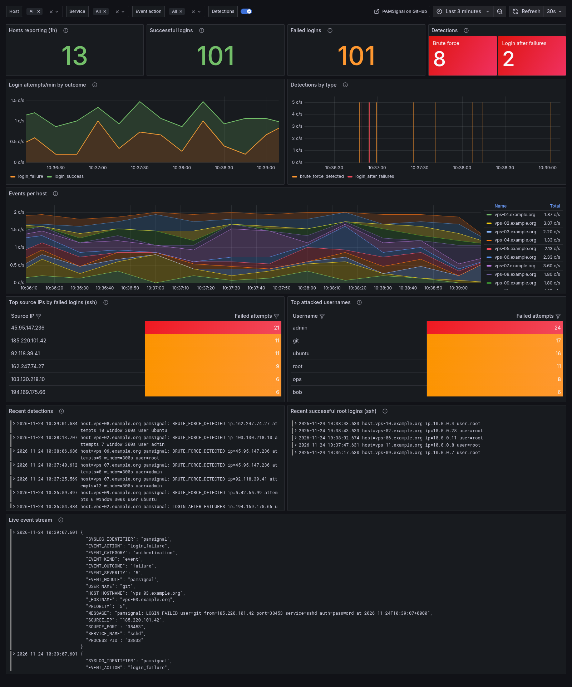

<p align="center">
  
</p>

# PAMSignal

> **English** · [Tiếng Việt](docs/vi/README.md)

[](https://github.com/anhtuank7c/pamsignal/actions/workflows/ci.yml)


**Know the moment someone logs in to your Linux server, or tries to.**

PAMSignal watches the systemd journal for SSH, `sudo`, `su` and console logins, and sends an alert to Telegram, Slack, Microsoft Teams, Discord, WhatsApp or your own webhook within seconds. One small C daemon, one config file, no agents or servers to run.

```text
[NOTICE] auth.login_success user=admin src=192.168.1.100:52341 host=web-01 service=sshd auth=publickey pid=4211 ts=2026-11-24T09:12:03+0700
[INFO]   auth.session_opened user=root actor=admin host=web-01 service=sudo pid=4250 ts=2026-11-24T09:12:40+0700
[ALERT]  auth.brute_force_detected src=203.0.113.50 attempts=12 window=300s user=root host=web-01 pid=4377 ts=2026-11-24T09:15:02+0700
[CRIT]   auth.login_after_failures user=root src=203.0.113.50:40122 failures=12 window=300s host=web-01 service=sshd auth=password pid=4390 ts=2026-11-24T09:15:20+0700
```

Prefer a multi-line message on your phone? Set `message_style = pretty`.

## What it catches

- **Logins**: successful and failed SSH logins, with source IP and auth method.
- **Privilege changes**: `sudo`, `su` and console sessions, including who became root (`actor=`).
- **Brute force**: repeated failures from one IP, or repeated wrong `sudo`/`su` passwords from one account.
- **A guessed password**: a successful login right after a run of failures from the same IP. This is the alert you never want to miss.

Every event is also written to the journal as structured fields (`journalctl -t pamsignal`), whatever you send to chat. Forged entries (for example `logger -t sshd`) are ignored.

## Quick start

### 1. Install

<details open>
<summary><strong>Debian / Ubuntu</strong></summary>

```bash
sudo install -d -m 0755 /etc/apt/keyrings
curl -fsSL https://anhtuank7c.github.io/pamsignal/key.asc | sudo gpg --dearmor -o /etc/apt/keyrings/pamsignal.gpg
echo "deb [signed-by=/etc/apt/keyrings/pamsignal.gpg] https://anhtuank7c.github.io/pamsignal stable main" | sudo tee /etc/apt/sources.list.d/pamsignal.list
sudo apt update && sudo apt install pamsignal
```
</details>

<details>
<summary><strong>Fedora / RHEL 9 / AlmaLinux 9 / Rocky Linux 9</strong></summary>

```bash
# Fedora
sudo dnf config-manager addrepo --from-repofile=https://anhtuank7c.github.io/pamsignal/rpm/fedora/pamsignal.repo
# RHEL 9 / AlmaLinux 9 / Rocky Linux 9
sudo dnf config-manager --add-repo https://anhtuank7c.github.io/pamsignal/rpm/el9/pamsignal.repo

sudo dnf install pamsignal
```
</details>

<details>
<summary><strong>Ubuntu 20.04 (Focal)</strong></summary>

Focal has no apt repository; install the signed `.deb` from the [latest release](https://github.com/anhtuank7c/pamsignal/releases):

```bash
VERSION=0.8.0
curl -fLO "https://github.com/anhtuank7c/pamsignal/releases/download/v${VERSION}/pamsignal_${VERSION}-1_focal_amd64.deb"
sudo apt install "./pamsignal_${VERSION}-1_focal_amd64.deb"
```
</details>

Packages are signed with key `2D2C 828F A6F4 D019 E446  8FBB B106 2235 2862 2F69`. Other distributions: see [Supported distributions](./docs/distros.md) or [build from source](./docs/development.md).

### 2. Add an alert channel

Edit `/etc/pamsignal/pamsignal.conf`. For Telegram:

```ini
telegram_bot_token = <your_bot_token>
telegram_chat_id = <your_chat_id>
```

Slack, Teams, Discord, WhatsApp and custom webhooks: [Alert setup](./docs/alerts.md).

### 3. Check, test, apply

```bash
sudo -u pamsignal pamsignal --check-config   # validate the file
sudo -u pamsignal pamsignal --test-alert     # send a test message to every channel
sudo systemctl reload pamsignal
journalctl -t pamsignal -f                   # watch events live
```

## Tuning

The defaults work out of the box. The keys you are most likely to change:

| Key | Default | What it does |
|---|---|---|
| `fail_threshold` / `fail_window_sec` | `5` / `300` | Failures within the window that count as brute force |
| `alert_cooldown_sec` | `60` | Seconds before the same alert repeats (same event, user and source; brute force: same source). `0` turns it off |
| `enable_notification_type` | `all` | Which events reach chat: `login_success`, `login_failed`, `session_open`, `session_close`, `brute_force`, `login_after_failures`, `all` |
| `trusted_sources` | empty | CIDR list (office, VPN, bastion) whose routine logins stay out of chat; attacks from them still alert |
| `message_style` | `compact` | `pretty` for a multi-line layout |
| `provider` / `service_name` | empty | Tags added to every alert, handy across many hosts or customers |

Every key, with ranges and examples: [Configuration](./docs/configuration.md).

## Works with your stack

- **Custom webhook**: alerts as ECS JSON for any SIEM or script, with optional bearer token and mTLS. Example receivers in [Node.js](./examples/nodejs-webhook/README.md) and [Python](./examples/python-webhook/README.md).
- **Fail2ban**: ban brute-forcing IPs at the firewall using PAMSignal's detection: [guide](./examples/fail2ban/README.md).
- **Grafana**: one dashboard for the whole fleet through Loki and Alloy: [Grafana from zero](./docs/grafana-getting-started.md).
- **who-did-what**: a read-only report of who logged in, who became root and what they ran: [script](./examples/who-did-what/README.md).



## Documentation

- [Secure SSH and manage a fleet](./docs/ssh-hardening.md): stop sharing root, harden `sshd`, trace who did what
- [Use cases](./docs/use-cases.md): solo, small team and hosting-provider setups
- [Configuration](./docs/configuration.md) · [Alerts and payloads](./docs/alerts.md) · [Deployment](./docs/deployment.md)
- [Threat model](./docs/threat-model.md): what PAMSignal sees and what it does not
- [Architecture](./docs/architecture.md) · [Development](./docs/development.md) · [Supported distributions](./docs/distros.md)
- [Security policy](./SECURITY.md) · [Contributing](./CONTRIBUTING.md) · [Changelog](./CHANGELOG.md)

## Acknowledgments

Thanks to [Nguyen Hong Quan](https://github.com/hongquan), whose push for reading PAM events from `systemd-journald` instead of `/var/log/auth.log`, and for strict FHS paths, shaped the design; and to [Samuel Le](https://github.com/lehiep1994), whose books and encouragement kept the project going.

PAMSignal is built with AI assistance ([Claude Code](https://claude.com/claude-code)); the `.claude/` directory shows exactly how. Every release is tested on real systems by a human who takes responsibility for it.

## License

[MIT](./LICENSE)
