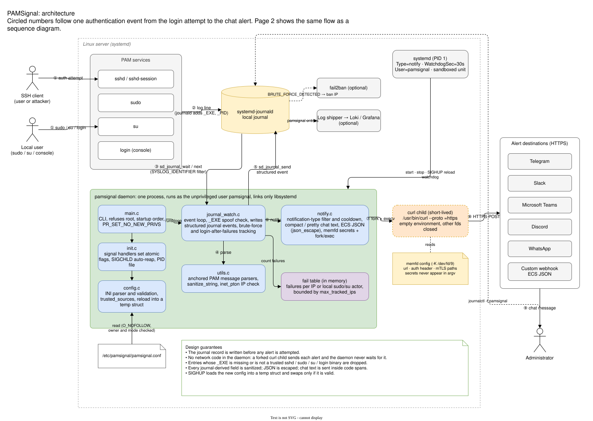
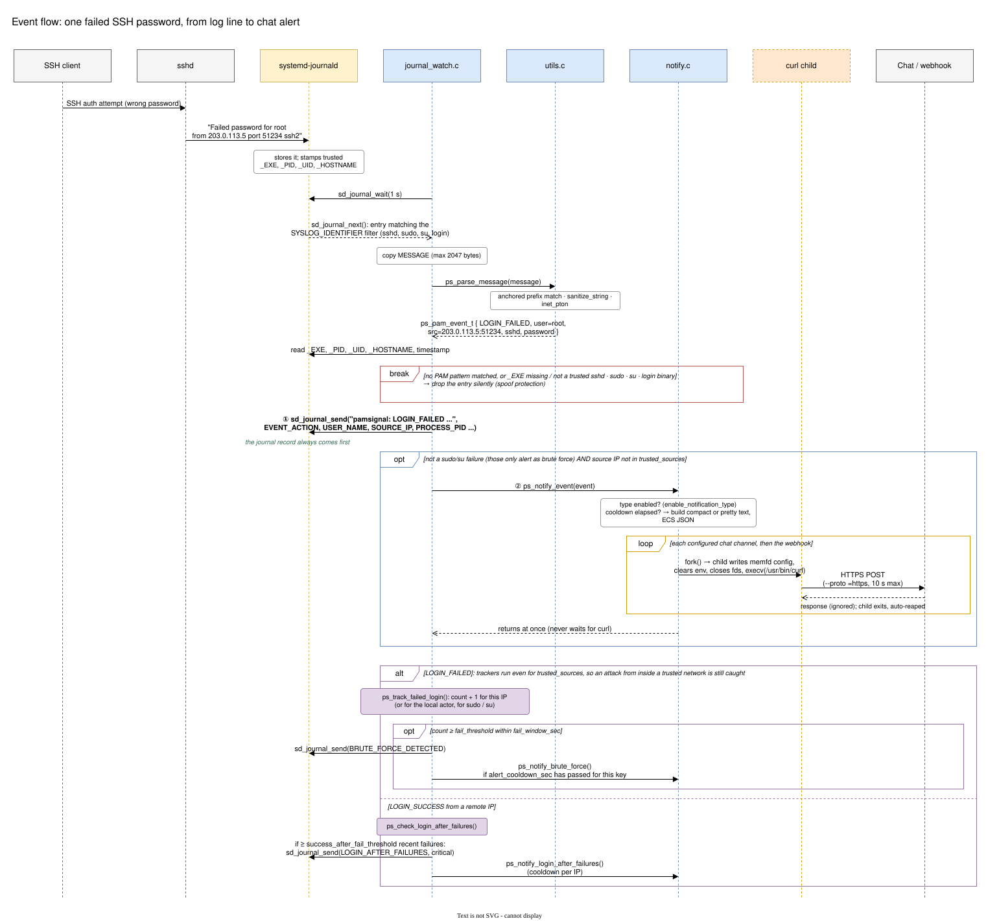
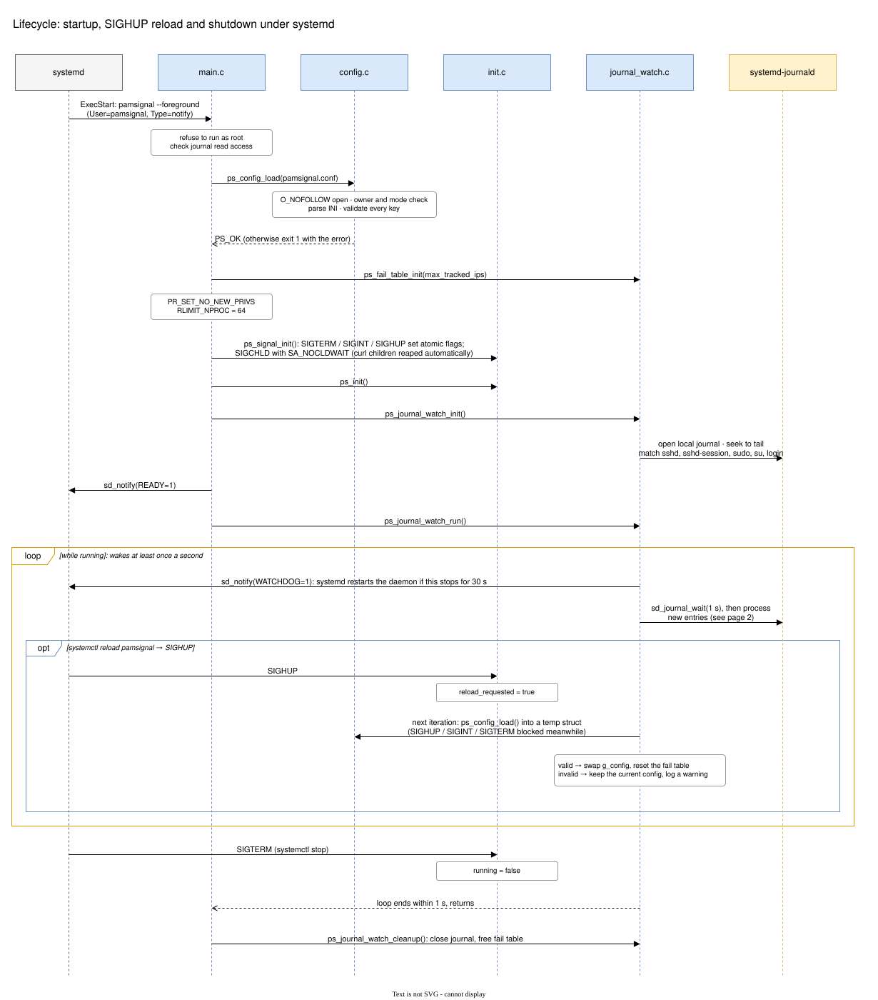

# Architecture

> 🌐 **English** · [Tiếng Việt](vi/architecture.md)

PAMSignal is designed around one core principle: **do one thing well with minimal moving parts.**

It subscribes to the systemd journal, filters for PAM-related messages from sshd, sudo, su, and login, parses each message to extract structured data (username, source IP, port, service, auth method), and writes structured events back to the journal with custom fields. It tracks failed login attempts per IP and detects brute-force patterns. Optionally, it sends best-effort alerts to messaging platforms without risking the core monitoring.

Single binary. Single config file. Single dependency (`libsystemd`). No database, no web server, no separate relay process.

## Diagrams

The diagrams below are editable SVG files: GitHub shows them as images, and opening the same file in [draw.io](https://www.drawio.com/) lets you edit it (see [Editing the diagrams](development.md#editing-the-diagrams)). Click a diagram to open it full size.

### Architecture

[](diagrams/architecture.drawio.svg)

The numbers follow one authentication event:

1. An SSH client, or a local user running `sudo` / `su` / `login`, tries to authenticate.
2. The PAM service writes a log line to journald, which stamps it with trusted metadata (`_EXE`, `_PID`, `_UID`, `_HOSTNAME`).
3. The daemon wakes from `sd_journal_wait()` and reads the entry, filtered to sshd, sshd-session, sudo, su and login.
4. `utils.c` parses the message into a structured event.
5. `journal_watch.c` writes the structured event back to the journal (see [Structured journal fields](#structured-journal-fields)).
6. `notify.c` decides whether the event should alert and formats it.
7. The daemon forks a short-lived `curl` child and does not wait for it.
8. curl sends the alert over HTTPS.
9. The administrator receives the chat message.

| Module | Responsibility |
|--------|----------------|
| `main.c` | CLI parsing, refusing root, journal access check, startup order, `PR_SET_NO_NEW_PRIVS` |
| `init.c` | Signal handlers (atomic flags), automatic reaping of curl children, PID file |
| `config.c` | INI parser, validation, `trusted_sources`, SIGHUP reload into a temporary struct |
| `journal_watch.c` | Journal subscription, event loop, `_EXE` spoof check, structured journal output, brute-force and login-after-failures tracking |
| `utils.c` | Anchored PAM message parsers, IP validation (`inet_pton`), log sanitization |
| `notify.c` | Notification-type filter and cooldown, chat text (compact / pretty), ECS JSON, memfd-backed curl config, fork+exec dispatch |

### Event flow

[](diagrams/event-flow.drawio.svg)

The journal record is always written before any alert is attempted. An entry that matches no PAM pattern, or whose `_EXE` is missing or is not a trusted sshd / sudo / su / login binary, is dropped. A per-event chat alert is skipped for sudo/su failures (those alert only as brute force) and for sources in `trusted_sources`; the brute-force and login-after-failures trackers still see every event.

### Lifecycle

[](diagrams/lifecycle.drawio.svg)

## Alert isolation model

Alerts are **best-effort and cannot break the core monitoring**. Here's how:

The [event flow](#event-flow) diagram shows this as step ②: the parent forks, the child runs curl, and the parent returns to the event loop without waiting.

**Why this is safe:**

1. The parent **always writes to the journal first** — the core record is persisted before any alert attempt
2. `fork()` creates a copy-on-write child — cheap on Linux, no shared state
3. The parent **does not wait** for the child — it continues the event loop immediately
4. If the child crashes, segfaults, or hangs — the parent is completely unaffected
5. If Telegram/Slack/Discord is down — the child times out and exits, pamsignal keeps monitoring
6. `SIGCHLD` is ignored (`SA_NOCLDWAIT`) so zombie processes are automatically reaped
7. The child `exec`s `curl` — no HTTP library linked into the parent process at all

### Curl invocation (memfd-backed config)

Every per-channel sender — Telegram, Slack/Teams/Discord, WhatsApp, custom webhook — funnels through one internal entry point (`post_alert` in `src/notify.c`) that writes the per-request configuration to an in-memory `memfd_create()`-backed file and passes it to curl as `-K /dev/fd/9`. The memfd has its CLOEXEC bit cleared via `dup2`; every other inherited file descriptor is closed in the child before `execv`.

What lands in the memfd config:

- `url = "<endpoint>"` — always present.
- `header = "<full Name: value>"` — present when the channel needs an auth header. WhatsApp uses this internally for its Meta Cloud API Bearer; the custom-webhook channel uses it for `webhook_auth_header`.
- `cert = "<path>"`, `key = "<path>"`, `cacert = "<path>"` — present when the custom-webhook channel has mTLS configured. The paths are not themselves secret (the file *contents* are, and stay on disk under the daemon's trust boundary), but routing them through the same memfd config keeps the curl child's `argv` minimal and uniform regardless of how many auth options are configured.

Effect on the curl child's `/proc/<pid>/cmdline`: every alert dispatch produces an `argv` of `curl -s -S --max-time 10 --proto =https --proto-redir =https -H "Content-Type: application/json" -K /dev/fd/9 -d <body>`, byte-identical no matter which channel it's for or which authentication mode is in use. A local unprivileged user reading `/proc/*/cmdline` cannot tell from the command line whether a token, a client cert, or both are configured, let alone harvest the values.

The `--proto =https` / `--proto-redir =https` flags stay on `argv` (not in the config file) so they're externally inspectable as a hardening guarantee — anyone reviewing the running process can confirm cleartext / non-HTTPS schemes are refused even before the validator gate.

## Structured journal fields

PAMSignal writes events using `sd_journal_send()` with [Elastic Common Schema (ECS)] aligned field names so existing SIEM tooling can ingest the journal directly via the standard ECS field names rather than a vendor-specific dictionary. (Through the v0.2.x series PAMSignal also emitted a parallel `PAMSIGNAL_*` field set; those legacy fields were retired in v0.3.0 — update any `journalctl PAMSIGNAL_EVENT=…` queries to the ECS forms below.)

For login / session events:

| Field | Example | Description |
|-------|---------|-------------|
| `EVENT_ACTION` | `login_failure` | One of `session_opened`, `session_closed`, `login_success`, `login_failure`, `brute_force_detected` |
| `EVENT_CATEGORY` | `authentication` | Comma-separated list; sessions add `session`, brute-force adds `intrusion_detection` |
| `EVENT_KIND` | `event` | `event` for observations, `alert` for brute-force |
| `EVENT_OUTCOME` | `failure` | `success`, `failure`, or `unknown` |
| `EVENT_SEVERITY` | `5` | 3=info, 4=notice, 5=warning, 8=alert |
| `EVENT_MODULE` | `pamsignal` | Always `pamsignal` |
| `USER_NAME` | `root` | For sshd this is the account being attacked; for sudo/su this is the local actor (`ruser`) |
| `SOURCE_IP` | `203.0.113.45` | Remote IP (validated). Empty / absent for pure-local sudo/su brute-force |
| `SOURCE_PORT` | `22` | Remote port (login events only) |
| `SERVICE_NAME` | `sshd` | PAM service: `sshd`, `sudo`, `su`, `login`, `other` |
| `HOST_HOSTNAME` | `web-01` | Server hostname |
| `PROCESS_PID` | `12345` | The sshd / sudo / su PID associated with the event |
| `PAMSIGNAL_ACTOR` | `alice` | Session events only: the account that ran `sudo`/`su`. Empty when it equals `USER_NAME` (an SSH login) or pam_unix logs no name |

For brute-force events the same `EVENT_*` set applies plus, for the local-actor variant only, `USER_TARGET_NAME` (e.g. `root`) — the user the actor was trying to elevate to.

Query examples:

```bash
# All pamsignal events
journalctl -t pamsignal

# Only failed logins
journalctl -t pamsignal EVENT_ACTION=login_failure

# Only brute-force alerts (both IP-keyed and local-actor-keyed)
journalctl -t pamsignal EVENT_ACTION=brute_force_detected

# Events from a specific IP
journalctl -t pamsignal SOURCE_IP=203.0.113.45

# JSON output (for scripting)
journalctl -t pamsignal -o json
```

[Elastic Common Schema (ECS)]: https://www.elastic.co/guide/en/ecs/current/index.html

## Design decisions

**Why systemd journal as the primary output?**
The journal is already there. It provides structured fields, access control, persistence, and rotation. Administrators can query with `journalctl` filters. Scripts can consume JSON output. No custom log format to maintain.

**Why fork+exec curl for alerts (not libcurl, not a separate relay)?**
Three concerns balanced:
- **Usability:** One binary, one config file. No Python, no pip, no second service to manage.
- **Isolation:** Child process crash cannot affect the parent. No HTTP library in the parent's address space.
- **Simplicity:** `curl` is pre-installed on every Linux server. No new dependency to compile or link.

A separate relay (journal subscriber in Python) is the architecturally purest approach but doubles the operational complexity. Fork+exec achieves the same fault isolation with zero user-facing complexity.

**Why non-root?**
The daemon only needs to read the journal. Running as root would widen the attack surface for zero benefit. The `systemd-journal` group grants read access.

**Why a static fail table (not a hash map)?**
The table is bounded at `max_tracked_ips` entries (default 256). A flat array with linear scan is simpler, has no allocator overhead, and is fast enough for this scale. If you're tracking 100,000 IPs, you need a different tool.

**Why INI config (not YAML/JSON)?**
Zero dependencies. The config has ~10 keys — YAML/JSON parsing libraries add complexity for no benefit. Sysadmins can edit it with `vi` in 10 seconds.

**Why no network code in the parent process?**
Every network dependency (libcurl, sockets, TLS) is an attack surface. A security monitoring tool should minimize its own attack surface. The parent reads from the journal, writes to the journal, and forks children for alerts. The children exec `curl` and exit. The parent never makes a network call.
