# Grafana Integration: Design

> **English** · [Tiếng Việt](vi/grafana-integration.md)

This document describes the design of the PAMSignal Grafana integration, as shipped, tracked in [issue #25](https://github.com/anhtuank7c/pamsignal/issues/25). Implementation artifacts live under `examples/grafana/`.

The goal: an operator with 5+ Linux hosts and zero Loki experience can go from `apt install pamsignal` to a working fleet-wide auth dashboard in under 30 minutes.

## Architecture

```mermaid
graph LR
    pamsignal["PAMSignal<br/>(per host)"]
    journald[("systemd-journald<br/>(per host)")]
    alloy["Grafana Alloy<br/>(per host)"]
    loki[("Loki")]
    grafana["Grafana"]
    operator["Operator"]

    pamsignal -- "sd_journal_send<br/>(ECS fields)" --> journald
    journald -- "SYSLOG_IDENTIFIER=pamsignal" --> alloy
    alloy -- "Loki push API<br/>(4 labels)" --> loki
    loki -- "LogQL queries" --> grafana
    grafana -- "fleet dashboard<br/>+ alerts" --> operator

    style pamsignal fill:#2d6a4f,stroke:#1b4332,color:#fff
    style journald fill:#264653,stroke:#1d3557,color:#fff
    style alloy fill:#457b9d,stroke:#1d3557,color:#fff
    style loki fill:#e9c46a,stroke:#f4a261,color:#000
    style grafana fill:#e76f51,stroke:#d62828,color:#fff
    style operator fill:#6c757d,stroke:#495057,color:#fff
```



PAMSignal already emits ECS-aligned structured fields via `sd_journal_send()`. Alloy scrapes journald for `SYSLOG_IDENTIFIER=pamsignal`, promotes a small set of low-cardinality fields to Loki labels, and forwards the rest as a JSON-encoded log line. Grafana queries Loki via LogQL.

No PAMSignal daemon changes are required.

## Schema (what PAMSignal already emits)

PAMSignal writes one journal entry per parsed event plus one per detection. These are the structured fields across those entries:

| Field | Values | Cardinality | Used as |
|---|---|---|---|
| `SYSLOG_IDENTIFIER` | `pamsignal` | 1 | Alloy filter selector |
| `EVENT_ACTION` | `session_opened`, `session_closed`, `login_success`, `login_failure`, `brute_force_detected`, `login_after_failures` | 6 | **Loki label** |
| `EVENT_CATEGORY` | `authentication`, `authentication,session`, `authentication,intrusion_detection` | 3 | log body |
| `EVENT_KIND` | `event`, `alert` | 2 | log body |
| `EVENT_OUTCOME` | `success`, `failure`, `unknown` | 3 | log body |
| `EVENT_SEVERITY` | 3, 4, 5, 8, 9 (numeric) | 5 | log body |
| `EVENT_MODULE` | `pamsignal` | 1 | log body |
| `PRIORITY` | 5 (per-event entries), 4 (`brute_force_detected`), 2 (`login_after_failures`) | 3 | log body |
| `SERVICE_NAME` | `sshd`, `sudo`, `su`, `login`, `other` | 5 | **Loki label** |
| `USER_NAME` | username (the actor for sudo/su failures and local brute force) | high | log body |
| `USER_TARGET_NAME` | sudo/su target (local brute force only) | high | log body |
| `PAMSIGNAL_ACTOR` | account that opened the session when it differs from `USER_NAME`, else empty (session events only) | high | log body |
| `SOURCE_IP` | remote address (empty when there is none) | high | log body |
| `SOURCE_PORT` | remote port | high | log body |
| `PROCESS_PID` | PID of the auth process | high | log body |
| `HOST_HOSTNAME` | hostname (also journald-native `_HOSTNAME`) | medium | (redundant) |

Not every entry carries every field:

| `EVENT_ACTION` | Severity | Fields besides `SYSLOG_IDENTIFIER`, `EVENT_*`, `USER_NAME`, `HOST_HOSTNAME` |
|---|---|---|
| `session_opened`, `session_closed` | 3 | `PAMSIGNAL_ACTOR`, `SERVICE_NAME`, `PROCESS_PID` |
| `login_success` | 4 | `SOURCE_IP`, `SOURCE_PORT`, `SERVICE_NAME`, `PROCESS_PID` |
| `login_failure` | 5 | `SOURCE_IP`, `SOURCE_PORT`, `SERVICE_NAME`, `PROCESS_PID` |
| `brute_force_detected` (remote, keyed by IP) | 8 | `SOURCE_IP` (no `SERVICE_NAME`) |
| `brute_force_detected` (local sudo/su, keyed by actor) | 8 | `USER_TARGET_NAME`, `SERVICE_NAME` |
| `login_after_failures` | 9 | `SOURCE_IP`, `SOURCE_PORT`, `SERVICE_NAME` |

`login_after_failures` is the strongest signal PAMSignal writes: a successful login from an IP that failed at least `success_after_fail_threshold` times (default 3), the last failure inside `fail_window_sec`. `trusted_sources` does not suppress it. A remote `brute_force_detected` entry has no `SERVICE_NAME`, so it reaches Loki without a `service` label.

Source of truth: `src/journal_watch.c` (`ps_log_event`, `emit_brute_force_alert`, `ps_check_login_after_failures`) and `src/utils.c` (`ps_event_action_str`, `ps_service_str`, `ps_event_outcome_str`, `ps_event_severity_num`).

## Label cardinality plan

Loki indexes labels, and high-cardinality labels blow up the index. The plan keeps cardinality bounded.

**Promoted to Loki labels (used in every selector):**

- `app="pamsignal"`: static, set by Alloy
- `host` ← `__journal__hostname`: one per host (bounded by fleet size)
- `service` ← `__journal_service_name`: 5 values (absent on remote `brute_force_detected`)
- `event_action` ← `__journal_event_action`: 6 values

`alloy.river` also adds a static `job="pamsignal"` external label, which does not change the stream count.

Total streams: `~5 × 6 × fleet_size ≈ 30 × N`. Safe up to thousands of hosts.

**Stay in the log body (parsed at query time via `| json`):**

- `SOURCE_IP`, `USER_NAME`, `USER_TARGET_NAME`, `PAMSIGNAL_ACTOR`, `SOURCE_PORT`, `PROCESS_PID`, `EVENT_SEVERITY`, `EVENT_OUTCOME`, `EVENT_KIND`

`event_outcome` and `event_kind` are derivable from `event_action`, so there's no point indexing them. Source IP and user name are high-cardinality; querying them on demand is the right tradeoff.

## Dashboard layout

`dashboards/pamsignal-v1.json` has 12 panels in six rows, top to bottom:

### Row 1: Fleet pulse (4 stat panels)

The "Friday-afternoon glance." Each panel is a single number, color-coded.

1. **Hosts reporting (1h)**: fleet liveness
2. **Successful logins** (range)
3. **Failed logins** (range)
4. **Detections** (range): two numbers, `brute_force_detected` and `login_after_failures`, red if > 0

### Row 2: Trends (2 time-series)

5. **Login attempts/min by outcome**: `login_success` vs `login_failure`, stacked
6. **Detections by type**: `brute_force_detected` and `login_after_failures` per minute (grouped by `event_action`, because remote brute-force entries have no `service` label)

### Row 3: Events per host

7. **Events per host**: top 10 hosts by event volume; spot the noisy host

### Row 4: Drill-down tables

8. **Top source IPs by failed logins (ssh)** (parsed `SOURCE_IP`)
9. **Top attacked usernames** (parsed `USER_NAME`)

### Row 5: Recent detections and root logins (2 logs panels)

10. **Recent detections**: `brute_force_detected` and `login_after_failures` entries, shown as `host=<host>` plus PAMSignal's own `MESSAGE` (ip or actor/target, attempts or failures, window, user)
11. **Recent successful root logins (ssh)**: `event_action="login_success"`, `service="sshd"` and `USER_NAME="root"`

### Row 6: Live event stream

12. **Live event stream**: PAMSignal events filtered by the dashboard variables

A dashboard annotation marks every detection on the time-series panels.

### Variables (multi-select, default "All")

- `$host` (from `host` label)
- `$service` (from `service` label; "All" also matches entries without one)
- `$action` (from `event_action` label)

### Default time range

Last 6h, auto-refresh every 30s. Quick options: 5m / 15m / 1h / 6h / 12h / 24h / 7d / 30d.

## LogQL query patterns

The four-label scheme keeps queries readable:

```logql
# Failed-login rate
count_over_time({app="pamsignal", event_action="login_failure",
                 host=~"$host", service=~"$service"}[1m])

# Detections by type
sum by (event_action) (
  count_over_time({app="pamsignal",
                   event_action=~"brute_force_detected|login_after_failures"}[5m])
)

# Top source IPs (parsed from JSON body)
topk(10,
  sum by (source_ip) (
    count_over_time(
      {app="pamsignal", event_action="login_failure"}
      | json source_ip="SOURCE_IP"
      | source_ip != ""
      [$__range]
    )
  )
)

# Successful root logins
{app="pamsignal", event_action="login_success", service="sshd"}
  | json user_name="USER_NAME"
  | user_name="root"

# Logins that followed a run of failures
{app="pamsignal", event_action="login_after_failures"}
  | json source_ip="SOURCE_IP", user_name="USER_NAME"
```

## Alerts

Shipped in `examples/grafana/alerts.yaml` as Grafana-native rules:

| # | Rule | Severity | Rationale |
|---|---|---|---|
| 1 | Any `event_action="brute_force_detected"` | critical | PAMSignal already validated the threshold; alert is trustworthy |
| 2 | `event_action="login_success"` AND `USER_NAME="root"` on `service="sshd"` | high | Direct root SSH is the canonical "you should care" event |
| 3 | ≥10 `login_failure` from one `SOURCE_IP` in 5 min | high | Safety net if operator tuned `fail_threshold` very high |
| 4 | Host stopped reporting > 10 min | medium | Heartbeat: daemon dead or host offline |
| 5 | Any `event_action="login_after_failures"` | critical | A source that kept failing then got in: possible compromise |

Off-hours login is policy-specific. Out of scope for v1.

## Try-it path (docker-compose)

PAMSignal needs systemd + journald, which is awkward inside containers. The try-it stack avoids this by including a **synthetic event producer** (small Python container) that writes pamsignal-shaped events with the same fields per action as the daemon. It pushes them directly to Loki via the HTTP push API and also appends them to a file that the stack's Alloy (`alloy/demo.alloy`) tails and forwards with the same labels. This is enough to demo the dashboard and run CI.

The "real PAMSignal" path is documented in `examples/grafana/README.md` and uses Alloy installed on the host.

## Deliverable layout

```
examples/grafana/
├── README.md              # integration guide (Loki-newcomer friendly)
├── alloy.river            # production Alloy config: journald → Loki
├── alloy/demo.alloy       # Alloy config for the try-it stack (tails a file)
├── dashboards/
│   ├── pamsignal-v1.json              # the dashboard (provisioning, uid "loki")
│   └── pamsignal-v1.grafana-com.json  # same dashboard for UI import (${DS_LOKI})
├── alerts.yaml            # Grafana alert rules (provisioning format)
├── config/loki-config.yml # Loki config for the try-it stack (7-day retention)
├── provisioning/          # Grafana datasource + dashboard provisioning
├── docker-compose.yml     # Loki + Alloy + Grafana try-it stack
├── synthetic/             # synthetic event producer (try-it & CI)
│   ├── Dockerfile
│   └── produce.py
└── verify.sh              # one-command integration health check
```

## Success criteria

Reproduced from the issue for tracking convenience:

1. Operator with 5+ Linux VPSes and zero Loki experience reaches a working dashboard in under 30 minutes following the guide.
2. The dashboard answers "what's happening with auth across my fleet right now?" at a glance.
3. The grafana.com listing reaches 1k+ downloads in the first 3 months. (The dashboard has not been submitted to grafana.com yet; the import-ready file ships in the repo.)
4. At least one outside contributor opens a PR improving the integration.
5. CI proves the integration still works on every Grafana / Loki / Alloy update.
