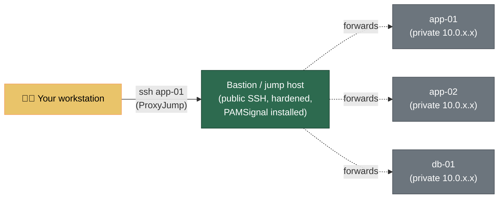

# Secure SSH & Manage a Fleet

> 🌐 **English** · [Tiếng Việt](vi/ssh-hardening.md)

SSH is the front door to your Linux server. PAMSignal tells you the instant someone knocks, rattles the handle, or gets in. This guide is about making the door itself hard to force, knowing exactly who walked through it and what they did, and managing that door across one server or fifty without losing your mind.

If you have only ever logged in as `root` with a password, some of this will feel like a lot at once. That's fine. You do it **once per server** and then never think about it again — and PAMSignal is watching the whole time, so you get immediate feedback that each change worked.

> **New to all this?** Read [Quick Start](../README.md#-quick-start) first so PAMSignal is installed and you've seen at least one line in `journalctl -t pamsignal`. Then come back here.

---

## Where this fits

PAMSignal is **one layer** in a defence-in-depth stack. It does exactly one job — *detect and alert* — and does it well. The other layers are still your job. This guide covers the most important one (Layer 1) and the basics of knowing who did what afterwards (Layer 4):

| Layer | Goal | Typical tools | Whose job |
|---|---|---|---|
| **1. Prevention** | Make the door hard to open | **Personal accounts instead of root, SSH key-only auth, `sshd_config` hardening, firewall** | **You — [Part 1](#part-1--harden-one-servers-ssh)** |
| 2. Integrity | Detect tampering with the system itself | AIDE, `debsums`, `rpm -V` | You |
| **3. Detection / Alerting** | Tell you when something happens | **PAMSignal** | **PAMSignal** |
| **4. Forensics** | Reconstruct who did what, after the fact | **sudo logs, `auditd`, an off-host copy of the logs** | **You — [Part 2](#part-2--know-who-did-what-on-a-shared-server)** |

PAMSignal **never touches `sshd`** — it doesn't change your SSH config, install a PAM module, or block anything. It reads PAM events from the systemd journal and tells you about them. So hardening SSH (this page) and detecting attacks on it (PAMSignal) are completely independent, complementary jobs. Hardening shrinks the attack surface; PAMSignal tells you when the remaining surface is being tested, and when something gets through.

The natural third partner is **automatic blocking** — see the [Fail2ban Integration Guide](../examples/fail2ban/README.md), which acts on PAMSignal's brute-force signal to drop attacker IPs at the firewall.

---

## Part 1 — Harden one server's SSH

Everything in this section runs **on the server**. Do it over an existing SSH session, and **keep that session open** until you've confirmed a new login works. That one habit saves you from every lock-out story you've ever heard.

### 1.1 Stop logging in as root: one account per person

Most people start by logging in as `root` for everything — and many teams then hand every member a key to that same `root` account. Switching to an SSH key is a big step up from a password, but **logging in as root is still risky even with a key**:

- **One stolen key is instant, total control.** A key copied off a laptop, a CI runner or a backup logs straight in as root. With a personal account, the attacker lands as an ordinary user and still has to get past `sudo` — a second barrier, and a second chance for you to notice.
- **Every mistake runs with full power.** A wrong `rm -rf`, `chmod -R` or `> /etc/…` in a root shell goes through without a prompt. Under a normal user, the command fails and you get to think again.
- **`root` is the one username every bot already knows.** Internet-wide scanners try `root` first, all day. Refusing root logins removes the most-guessed target entirely.

On a **shared** server, root logins also destroy accountability. When five people log in as `root` with five different keys:

| Question after an incident | Shared `root` account | One account per person + `sudo` |
|---|---|---|
| Who logged in? | Only the key fingerprint in the sshd log — you have to map it back to a person by hand | The username: `login_success user=alice` |
| Who became root? | Everyone already is root | `sudo` logs every elevation with the person's name; PAMSignal alerts show `actor=alice` |
| Which commands did they run? | One shared `/root/.bash_history`, interleaved, rewritten on every logout, and erasable by anyone | `sudo` logs each command; `auditd` records commands under the person's login ID (see [Part 2](#part-2--know-who-did-what-on-a-shared-server)) |
| Who changed `/etc/nginx/nginx.conf`? | The audit trail says `uid=0` — every time | `auditd` names the person even when they edited it as root |
| Someone leaves the team | Remove their key from root and hope nobody copied it | Lock or delete their account; nothing shared to rotate |

So the rule is simple: **everyone gets their own account and their own key, and does admin work through `sudo`.** Automation (CI deploys, backups) gets its own account too, with only the `sudo` rights it needs.

**Create a personal account** (repeat for each person). The public key comes from that person — they generate it on their own machine as in [1.2](#12-use-ssh-keys-not-passwords) and send you the `.pub` file:

```bash
# Debian / Ubuntu
sudo adduser alice                  # sets a password, used only for sudo prompts — SSH stays key-only
sudo usermod -aG sudo alice

# RHEL / Fedora / AlmaLinux / Rocky
sudo useradd -m alice && sudo passwd alice
sudo usermod -aG wheel alice

# Install alice's PUBLIC key (alice.pub is the file she sent you)
sudo install -d -m 700 -o alice -g alice /home/alice/.ssh
sudo install -m 600 -o alice -g alice alice.pub /home/alice/.ssh/authorized_keys
```

Ask the person to test, **from a new terminal**, before you change anything else:

```bash
ssh alice@your-server.example.com
sudo -v          # asks for alice's password, then succeeds
```

**Moving a team off a shared root account.** Do this once, with your current root session kept open:

1. **List the keys that can log in as root** and identify the owner of each:

   ```bash
   sudo ssh-keygen -lf /root/.ssh/authorized_keys     # one line per key: fingerprint + comment
   ```

2. **See which of those keys are actually used.** sshd logs the fingerprint of the key behind every login:

   ```bash
   sudo journalctl -t sshd -t sshd-session --since "-30 days" | grep "Accepted publickey for root"
   # … Accepted publickey for root from 203.0.113.5 port 51234 ssh2: ED25519 SHA256:Xb3f…
   ```

3. **Create an account for each person** (above) and move their key from root's `authorized_keys` into their own.
4. **Each person confirms** they can log in and run `sudo -v`.
5. **Close the root door:** disable root's keys, then set `PermitRootLogin no` in [1.3](#13-lock-down-sshd_config-with-a-drop-in):

   ```bash
   sudo mv /root/.ssh/authorized_keys /root/.ssh/authorized_keys.disabled
   ```

> **Use `sudo <command>`, not a root shell.** `sudo -i`, `sudo su -` and `sudo bash` are convenient, but `sudo` then logs only that you *opened* a shell — not what you typed inside it. Prefer `sudo systemctl restart nginx` over a long-lived root shell, and turn on the session recording in [2.3](#23-what-they-typed-inside-a-root-shell) so the shell case is covered too.

### 1.2 Use SSH keys, not passwords

A password can be guessed, phished, or brute-forced. An SSH key cannot — it's a cryptographic secret that never leaves your machine. This is the single highest-impact change you can make.

**On your workstation** (laptop/desktop — *not* the server), generate a modern key if you don't have one:

```bash
ssh-keygen -t ed25519 -C "you@workstation"
# Press Enter for the default path (~/.ssh/id_ed25519).
# ALWAYS set a passphrase — it encrypts the key on disk.
```

`ed25519` is the current best-practice algorithm: short, fast, and strong. (If your organisation issues hardware security keys — YubiKey and friends — use `-t ed25519-sk` instead, which keeps the private key on the hardware.)

Copy the **public** key to the server — to **your own account**, not to root:

```bash
ssh-copy-id you@your-server.example.com
# Or, if ssh-copy-id isn't available:
# ssh you@your-server.example.com 'mkdir -p ~/.ssh && cat >> ~/.ssh/authorized_keys' < ~/.ssh/id_ed25519.pub
```

**Now test it before changing anything else.** Open a *new* terminal and run:

```bash
ssh you@your-server.example.com
```

If it logs you in **without asking for your account password** (a key passphrase prompt is fine and expected), keys work. Only then continue.

### 1.3 Lock down `sshd_config` with a drop-in

Modern distros (Debian 12+, Ubuntu 22.04+, RHEL 9+) read extra config from `/etc/ssh/sshd_config.d/*.conf`. Dropping your hardening into its own file there is cleaner than editing the big `sshd_config` — it survives package upgrades untouched and is trivial to audit or remove.

Create `/etc/ssh/sshd_config.d/00-hardening.conf`:

```ini
# Authentication: keys only, no passwords, no root login at all.
PubkeyAuthentication yes
PasswordAuthentication no
KbdInteractiveAuthentication no
PermitRootLogin no
PermitEmptyPasswords no

# Slow down and bound each connection attempt.
MaxAuthTries 3
LoginGraceTime 20
MaxSessions 4

# Only these users (or groups) may log in at all. Adjust to your accounts.
AllowUsers alice bob deploy
# AllowGroups ssh-users

# Turn off things you almost certainly don't need.
X11Forwarding no
AllowAgentForwarding no
```

A few notes that matter:

- **`PermitRootLogin no`** refuses every root login, key or password. Set it only **after** your own account logs in and `sudo -v` works ([1.1](#11-stop-logging-in-as-root-one-account-per-person)) — otherwise you lock yourself out. If you can't move off root yet, use `PermitRootLogin prohibit-password` (keys only) as a temporary step, not the destination.
- **The file name prefix matters.** `sshd` uses the **first** value it finds for each keyword, and `Include /etc/ssh/sshd_config.d/*.conf` is read in lexical order. Cloud images often ship a `50-cloud-init.conf` that *enables* password auth. A `00-` prefix sorts first, so your value wins. If your setting seems ignored, this is almost always why — check `sudo sshd -T | grep -i passwordauthentication` for the *effective* value.
- **`AllowUsers`** is a powerful allow-list: anyone not named simply cannot authenticate. Make sure your own account is in it before reloading. For a team, `AllowGroups ssh-users` plus `sudo usermod -aG ssh-users alice` is easier to maintain.

### 1.4 Validate, then reload (without dropping your session)

**Always** check the syntax before applying — a typo here can lock everyone out:

```bash
sudo sshd -t          # prints nothing if the config is valid
sudo sshd -T | grep -iE 'passwordauthentication|permitrootlogin|allowusers'   # confirm effective values
```

Then reload. A *reload* re-reads the config without killing existing connections:

```bash
# Debian / Ubuntu — the unit is named "ssh"
sudo systemctl reload ssh

# RHEL / Fedora / AlmaLinux / Rocky — the unit is named "sshd"
sudo systemctl reload sshd
```

**The safety check:** with your current session still open, open a brand-new terminal and SSH in again. If it works, you're done. If it doesn't, you still have the old session to fix things. Never close that first session until the new one succeeds.

### 1.5 Watch PAMSignal confirm it

This is the satisfying part. Tail PAMSignal and watch your changes take effect in real time:

```bash
journalctl -t pamsignal -f
```

- Your key login shows up as `login_success user=alice ... auth=publickey` — with your name, not `root`.
- When you run `sudo`, you see `session_opened user=root actor=alice service=sudo`: who became root, not just that someone did.
- A bot trying a password now fails *instantly* — you'll see `login_failure ... auth=password` with no chance of success.
- Once a single IP crosses your `fail_threshold`, you get a `brute_force_detected` line (and a chat alert if configured).

You've just closed the loop: prevention (Part 1) made the door strong, and detection (PAMSignal) proves it and watches it.

### 1.6 Optional extras

- **Change the port.** Moving SSH off `22` (e.g. `Port 2222`) won't stop a *targeted* attacker, but it dramatically cuts the background noise of internet-wide scanners — which means fewer junk alerts. If you do this, update your firewall and your `~/.ssh/config` ([Part 3](#part-3--manage-many-servers-without-the-pain)). Security by obscurity is a bonus, never the plan.
- **Firewall.** Restrict port 22/2222 to known IPs where you can (`ufw`, `firewalld`, or your cloud provider's security groups). A bastion ([Part 3](#part-3--manage-many-servers-without-the-pain)) lets you expose SSH on *one* host instead of all of them.
- **Two-factor.** For high-value hosts, add TOTP via `libpam-google-authenticator`. This is still Layer 1 (prevention) and lives in your PAM stack — PAMSignal will simply report the resulting successes and failures.

---

## Part 2 — Know who did what on a shared server

When several people administer the same server, sooner or later someone asks: *who restarted the database, who changed this config, who deleted that file?* With personal accounts ([1.1](#11-stop-logging-in-as-root-one-account-per-person)) every one of those questions has an answer. This part shows where each answer lives and how to switch on the pieces that are off by default.

### 2.1 Who logged in, with which key

- **PAMSignal** records every login with the username, source IP and auth method — `journalctl -t pamsignal`, or the chat alert.
- **sshd** logs the fingerprint of the exact key used. If one person has several keys (laptop, desktop), this tells you which device it came from:

  ```bash
  sudo journalctl -t sshd -t sshd-session | grep "Accepted publickey"
  # … Accepted publickey for alice from 203.0.113.5 port 51234 ssh2: ED25519 SHA256:Xb3f…

  sudo ssh-keygen -lf /home/alice/.ssh/authorized_keys     # match the fingerprint to a key comment
  ```

- **`last`** and **`lastlog`** give a quick overview of recent and last logins per account.

### 2.2 Who became root, and the commands they ran with sudo

`sudo` writes one line per command to the journal, with the real person's name — nothing to install:

```bash
sudo journalctl -t sudo --since today
# … sudo[48211]:    alice : TTY=pts/1 ; PWD=/home/alice ; USER=root ; COMMAND=/usr/bin/systemctl restart nginx
```

PAMSignal turns the same moment into a `session_opened … actor=alice service=sudo` alert, so you see elevations in real time. Repeated wrong `sudo` passwords from one person raise a `brute_force_detected actor=… target=root` alert.

The gap: if someone runs `sudo -i`, `sudo su -` or `sudo bash`, this log shows only the shell being started. The next two sections close that gap.

### 2.3 What they typed inside a root shell

**Option A — record sudo sessions.** sudo can record the terminal output of every session it starts, root shells included, and replay it later like a video. Create `/etc/sudoers.d/10-session-log` with `sudo visudo -f /etc/sudoers.d/10-session-log`:

```text
Defaults use_pty
Defaults log_output
Defaults!/usr/bin/sudoreplay !log_output
```

```bash
sudo sudoreplay -l user alice            # list alice's recorded sessions
sudo sudoreplay 000003                   # replay one session (the TSID from the list)
```

Recordings are stored under `/var/log/sudo-io/`, readable only by root. Prefer `log_output` over `log_input`: input logging also captures keystrokes that are not shown on screen, such as passwords typed into other programs.

**Option B — `auditd` command logging.** The Linux audit system records every program a person starts, tagged with their **login ID** (`auid`). The login ID is set once at login and does not change when they run `sudo` or `su`. So even inside a root shell, each command is still recorded under the name of the person who opened the session.

```bash
# Debian / Ubuntu (RHEL-family systems already have it, as the "audit" package)
sudo apt-get install auditd
```

Create `/etc/audit/rules.d/50-user-commands.rules`:

```text
# Keep the login ID from being changed after login.
--loginuid-immutable

# Every program started by a human (auid >= 1000), including under sudo / su.
-a always,exit -F arch=b64 -S execve -F auid>=1000 -F auid!=unset -k user-cmd
-a always,exit -F arch=b32 -S execve -F auid>=1000 -F auid!=unset -k user-cmd
```

```bash
sudo augenrules --load
sudo ausearch -k user-cmd -ul "$(id -u alice)" --start today -i
# type=EXECVE … : argc=3 a0=systemctl a1=restart a2=nginx
# type=SYSCALL … : … auid=alice uid=root euid=root … tty=pts1 ses=12 comm=systemctl exe=/usr/bin/systemctl key=user-cmd
```

`auid=alice uid=root` reads as "alice, acting as root". `ses=12` groups all commands from the same login session. Command logging produces a lot of records on a busy server, so check `max_log_file` and `num_logs` in `/etc/audit/auditd.conf` to make sure the disk can hold the history you need.

What to expect when you read the results:

- **Just the command lines:** each command is an `EXECVE` record (what ran) next to a `SYSCALL` record (who ran it). Add `| grep '^type=EXECVE'` to see only the commands.
- **Background records at every login:** logging in runs login scripts (the message of the day, the systemd user session) under the person's login ID, so each login adds a few dozen records besides what they typed.
- **Shell built-ins are not programs:** `echo`, `cd` and redirections such as `> file` don't start a program, so they never appear here. A file watch (2.4) records what they change.
- **In scripts and cron jobs, add `--input-logs`:** without a terminal, `ausearch` reads from standard input instead of the audit log and prints `<no matches>`.

Use A for "show me exactly what happened on screen" and B for "list every command this person ran"; on a shared production server, run both.

### 2.4 Who changed which file

`auditd` can also watch the files that matter and record every write or permission change, again with the person's login ID:

```text
# /etc/audit/rules.d/60-watch-files.rules — adjust the paths to your server
-w /etc/ssh/sshd_config -p wa -k sshd-config
-w /etc/ssh/sshd_config.d/ -p wa -k sshd-config
-w /etc/sudoers -p wa -k sudoers
-w /etc/sudoers.d/ -p wa -k sudoers
-w /etc/nginx/ -p wa -k nginx-config
-w /var/www/ -p wa -k webroot
```

```bash
sudo augenrules --load
sudo ausearch -k nginx-config --start today -i
# … auid=alice uid=root … comm=vim exe=/usr/bin/vim.basic … name=/etc/nginx/nginx.conf … key=nginx-config
```

`-p wa` means writes and attribute changes (owner, mode). Watching a directory also catches editors that save through a temporary file and rename it. Avoid watching all of `/etc` or `/var`: package upgrades would bury the changes you care about.

### 2.5 Why shell history is not an audit trail

`~/.bash_history` is a convenience, not evidence:

- It is written when the shell exits, so a session that is still open, or that was killed, may be missing.
- Its owner can edit or delete it, turn it off with `unset HISTFILE`, or hide a command by starting it with a space.
- On a shared `root` account, everyone writes to the same `/root/.bash_history`, so there is no way to tell whose command is whose.

Use the sudo log, sudo session recordings and `auditd` (2.2–2.4) as the record of what happened. History is only a memory aid.

### 2.6 Keep the trail where an intruder can't erase it

Anyone with root on the server can delete local logs and stop `auditd`. For records you can rely on after a break-in, keep a copy somewhere else:

- **Make the journal persistent** so it survives reboots: `sudo mkdir -p /var/log/journal && sudo systemctl restart systemd-journald` (most distros already do this).
- **Ship logs off the server** as they are written: `systemd-journal-upload`, rsyslog forwarding, or the Grafana/Loki pipeline in [Grafana from Zero](./grafana-getting-started.md). For audit records, `audisp-remote` sends them to a central `auditd`.
- **Lock the audit rules** by adding `-e 2` as the last rule: then nobody can change or remove the rules without a reboot, and a reboot is itself visible.
- **PAMSignal's chat alerts are already off-host.** Even if the local journal is wiped later, the alert telling you who logged in and who became root is already in your chat channel.

### 2.7 Where to look — quick reference

| Question | Where the answer is | Command |
|---|---|---|
| Who logged in, from where? | PAMSignal, in real time | `journalctl -t pamsignal` |
| Which key (which device)? | sshd log, key fingerprint | `journalctl -t sshd -t sshd-session \| grep Accepted` |
| Who became root? | sudo log, PAMSignal `actor=` | `journalctl -t sudo` |
| Which commands with sudo? | sudo log | `journalctl -t sudo` |
| What happened inside a root shell? | sudo session recording | `sudoreplay -l user alice` |
| Every command a person ran, even as root | `auditd`, keyed by login ID | `ausearch -k user-cmd -ul <uid> -i` |
| Who changed a file? | `auditd` file watches | `ausearch -k <key> -i` |
| Can I trust the local logs? | Only if a copy left the server | Your log server / Loki |

To get all of these in one report, use the read-only [`who-did-what`](../examples/who-did-what/README.md) script: `sudo who-did-what --user alice --since yesterday`.

---

## Part 3 — Manage many servers without the pain

Once you have more than two or three servers, two problems show up: you can't remember every IP/port/user, and you don't want to expose SSH on every box to the whole internet. Both are solved on **your workstation** with `~/.ssh/config` — no server changes needed.

### 3.1 Give every server a name

Create or edit `~/.ssh/config` on your laptop:

```ini
# ~/.ssh/config  — on YOUR workstation, not the servers.

# Defaults applied to every host below.
Host *
    AddKeysToAgent yes
    ServerAliveInterval 60
    ServerAliveCountMax 3
    HashKnownHosts yes

Host web-01
    HostName 203.0.113.10
    User alice
    Port 2222
    IdentityFile ~/.ssh/id_ed25519

Host web-02
    HostName 203.0.113.11
    User alice

# One block can cover a whole naming scheme via wildcards.
Host db-*
    User alice
    IdentityFile ~/.ssh/id_ed25519_db
```

Now instead of `ssh -p 2222 alice@203.0.113.10`, you type:

```bash
ssh web-01
```

Tab-completion, `scp file web-02:/tmp/`, and `rsync` all understand these aliases. This is the single biggest quality-of-life upgrade for managing a fleet — and it makes the fleet rollout in [Part 4](#part-4--roll-pamsignal-out-across-the-fleet) trivial, because every tool can refer to hosts by name.

### 3.2 Reach private servers through a bastion (jump host)

The best way to expose SSH for a fleet is to expose it on **exactly one** hardened, monitored host — the *bastion* (or *jump host*) — and keep every other server on a private network reachable only through it. `ProxyJump` makes this a one-liner from your side:

```ini
Host bastion
    HostName bastion.example.com
    User alice
    Port 2222

# Every host on the private 10.0.x.x range is reached via the bastion.
Host 10.0.*.*
    ProxyJump bastion
    User alice

Host app-01
    HostName 10.0.1.21
    ProxyJump bastion
    User alice
```

`ssh app-01` now transparently hops through the bastion. The connection to `app-01` is end-to-end encrypted — the bastion only forwards bytes, it never sees your session.



**Why this pairs so well with PAMSignal:** the bastion becomes the one internet-facing SSH surface, so it absorbs essentially all the brute-force traffic. Install PAMSignal there and your alerts concentrate where the attacks actually land. Install it on the private hosts too, and any login that *didn't* come through the bastion is an immediate red flag.

> **Prefer `ProxyJump` over agent forwarding.** Agent forwarding (`ForwardAgent yes`) exposes your keys to whatever host you land on. `ProxyJump` doesn't — your keys never touch the bastion. Only forward your agent to hosts you fully trust.

### 3.3 Key hygiene at fleet scale

- **One account and one key per person, never a shared account or a shared key** ([1.1](#11-stop-logging-in-as-root-one-account-per-person)). If an admin leaves, you lock *their* account and remove *their* public key everywhere — you don't have to rotate a secret everyone shared.
- **Distribute accounts and `authorized_keys` with config management** ([Part 4](#part-4--roll-pamsignal-out-across-the-fleet)), never by hand. A file you edit by hand on 30 servers will drift.
- **Use a passphrase + `ssh-agent`** so the key is encrypted at rest but you type the passphrase once per session.

---

## Part 4 — Roll PAMSignal out across the fleet

You hardened the doors; now put a sensor behind each one. The goal: every host runs PAMSignal, they share a sane config, and they all report into one place (chat for real-time pings, [Grafana](./grafana-getting-started.md) for the fleet-wide view).

### 4.1 The quick way: a loop over your SSH aliases

For a handful of hosts, the `~/.ssh/config` names from [Part 3](#part-3--manage-many-servers-without-the-pain) make a one-liner enough. Install per the [Deployment guide](./deployment.md) on each:

```bash
for h in bastion web-01 web-02 db-01; do
  echo "== installing on $h =="
  ssh "$h" 'sudo apt-get update && sudo apt-get install -y pamsignal'   # assumes the repo is already configured
done
```

…and verify the whole fleet at once:

```bash
for h in bastion web-01 web-02 db-01; do
  echo "== $h =="
  ssh "$h" 'systemctl is-active pamsignal; journalctl -t pamsignal -n 2 --no-pager'
done
```

### 4.2 The repeatable way: Ansible

Past a handful of hosts, use config management so the install **and** the config are reproducible. Ansible reads your `~/.ssh/config` aliases natively. A minimal starting point:

```ini
# inventory.ini
[pamsignal_fleet]
bastion
web-01
web-02
db-01
```

```yaml
# install-pamsignal.yml
- hosts: pamsignal_fleet
  become: true
  tasks:
    - name: Install pamsignal (Debian/Ubuntu)
      ansible.builtin.apt:
        name: pamsignal
        state: present
        update_cache: true
      when: ansible_os_family == "Debian"

    - name: Install pamsignal (RHEL family)
      ansible.builtin.dnf:
        name: pamsignal
        state: present
      when: ansible_os_family == "RedHat"

    - name: Deploy the shared config
      ansible.builtin.template:
        src: pamsignal.conf.j2
        dest: /etc/pamsignal/pamsignal.conf
        owner: root
        group: pamsignal
        mode: "0640"
      notify: reload pamsignal

    - name: Enable and start
      ansible.builtin.systemd:
        name: pamsignal
        enabled: true
        state: started

  handlers:
    - name: reload pamsignal
      ansible.builtin.systemd:
        name: pamsignal
        state: reloaded
```

```bash
ansible-playbook -i inventory.ini install-pamsignal.yml
```

Because the config is a Jinja template (`pamsignal.conf.j2`), you can set **per-host context tags** from inventory variables — `provider` and `service_name` are appended to every alert so you always know which host (or which customer) an alert came from:

```ini
# pamsignal.conf.j2  (excerpt)
provider = {{ pamsignal_provider | default('selfhosted') }}
service_name = {{ inventory_hostname }}
```

That per-host tagging is the foundation of the multi-tenant patterns in [Use Cases → Small hosting provider](./use-cases.md#small-hosting-provider--msp).

### 4.3 One config, many hosts

Keep a single canonical `pamsignal.conf` in your config-management repo and push it everywhere. The keys most worth standardising across a fleet:

- `fail_threshold` / `fail_window_sec` — your fleet-wide definition of "brute force".
- `enable_notification_type` — narrow the chat noise (e.g. `login_success,brute_force`); the local journal still records everything. See [Configuration](./configuration.md#notification-type-filter).
- The alert-channel credentials — usually one shared channel for the fleet, or one per environment.

Reload everywhere after a config change without restarting:

```bash
for h in bastion web-01 web-02 db-01; do ssh "$h" 'sudo systemctl reload pamsignal'; done
# …or, with Ansible, just re-run the playbook — the handler reloads only changed hosts.
```

---

## Don't lock yourself out — the checklist

Hardening and automation are exactly where lock-outs happen. Before you walk away from any host:

- [ ] **A second session is still open** while you test the change.
- [ ] **A new SSH login succeeds** *before* you close the old session.
- [ ] **Before `PermitRootLogin no`, your own account logs in and `sudo -v` succeeds.**
- [ ] **Your account is in `AllowUsers`** (if you set it).
- [ ] **You know your out-of-band path** — cloud serial console, hypervisor, or physical access — in case all SSH fails.
- [ ] If you also run [Fail2ban](../examples/fail2ban/README.md), **your own IP is in `ignoreip`** so a fat-fingered password can't ban you.

---

## How PAMSignal complements this — at a glance

| What you did | Layer | What it buys you | What PAMSignal adds |
|---|---|---|---|
| One account per person, `PermitRootLogin no` | Prevention | A stolen key no longer means instant root; every action has a name | Login and `sudo`/`su` alerts name the person (`user=`, `actor=`) |
| Key-only auth, `sshd_config` hardening | Prevention | Password attacks can't succeed | Tells you the instant they're attempted, and confirms each legit login |
| sudo logging, `auditd`, off-host logs | Forensics | Answers "who ran what, who changed which file" | A real-time alert that points you at the session to investigate |
| Bastion + private network | Prevention | One small attack surface instead of many | Concentrates alerts on the bastion; flags any login that bypassed it |
| Fail2ban on the brute-force signal | Response | Repeat offenders blocked at the firewall | Provides the validated `brute_force_detected` signal Fail2ban acts on |
| Fleet rollout + per-host tags | Operations | Reproducible, named, monitored fleet | One real-time + [one fleet-wide](./grafana-getting-started.md) view of all auth activity |

PAMSignal does not *replace* any of these — it makes them observable. A hardened server you can't see is a server you're trusting blindly; PAMSignal is how you stop trusting blindly.

---

## Further reading

- 🔒 **[Deployment](./deployment.md)** — install, systemd hardening directives, uninstall
- ⚙️ **[Configuration](./configuration.md)** — every config key, including the notification-type filter
- 🛡️ **[Fail2ban Integration](../examples/fail2ban/README.md)** — turn the brute-force signal into automatic IP bans
- 📊 **[Grafana from Zero](./grafana-getting-started.md)** — one dashboard for the whole fleet's auth activity
- 🎯 **[Threat Model — Observation scope](./threat-model.md#observation-scope)** — which access channels PAMSignal can and cannot see (read this before you assume SSH is your only door)
- 🧩 **[Use Cases](./use-cases.md)** — solo, small team, and hosting-provider playbooks
