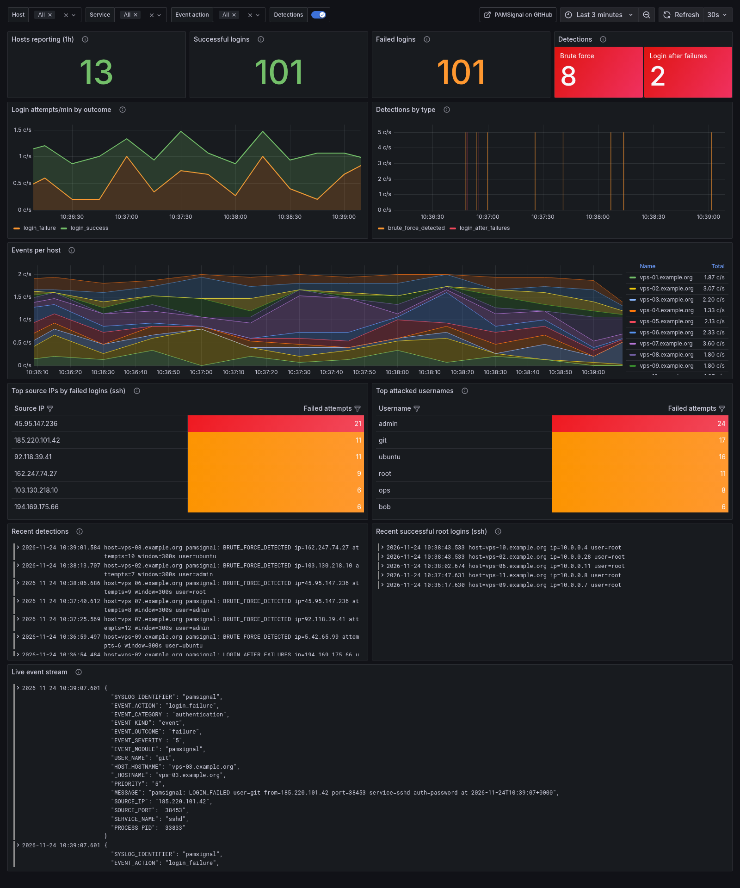

<p align="center">
  
</p>

# PAMSignal

> [English](../../README.md) · **Tiếng Việt**

[](https://github.com/anhtuank7c/pamsignal/actions/workflows/ci.yml)


**Biết ngay khi có người đăng nhập vào Linux server của bạn, hoặc đang cố đăng nhập.**

PAMSignal theo dõi systemd journal để bắt các lần đăng nhập SSH, `sudo`, `su` và console, rồi gửi cảnh báo tới Telegram, Slack, Microsoft Teams, Discord, WhatsApp hoặc webhook của bạn chỉ trong vài giây. Một daemon C nhỏ, một file cấu hình, không cần agent hay server nào khác.

```text
[NOTICE] auth.login_success user=admin src=192.168.1.100:52341 host=web-01 service=sshd auth=publickey pid=4211 ts=2026-11-24T09:12:03+0700
[INFO]   auth.session_opened user=root actor=admin host=web-01 service=sudo pid=4250 ts=2026-11-24T09:12:40+0700
[ALERT]  auth.brute_force_detected src=203.0.113.50 attempts=12 window=300s user=root host=web-01 pid=4377 ts=2026-11-24T09:15:02+0700
[CRIT]   auth.login_after_failures user=root src=203.0.113.50:40122 failures=12 window=300s host=web-01 service=sshd auth=password pid=4390 ts=2026-11-24T09:15:20+0700
```

Muốn tin nhắn nhiều dòng dễ đọc trên điện thoại? Đặt `message_style = pretty`.

## Nó phát hiện những gì

- **Đăng nhập**: các lần đăng nhập SSH thành công và thất bại, kèm IP nguồn và phương thức xác thực.
- **Thay đổi quyền**: các phiên `sudo`, `su` và console, kể cả ai đã lên root (`actor=`).
- **Brute force**: nhiều lần thất bại từ một IP, hoặc một tài khoản gõ sai password `sudo`/`su` nhiều lần.
- **Password bị đoán trúng**: một lần đăng nhập thành công ngay sau chuỗi thất bại từ cùng một IP. Đây là cảnh báo bạn không bao giờ muốn bỏ lỡ.

Mọi sự kiện đều được ghi vào journal dưới dạng các trường có cấu trúc (`journalctl -t pamsignal`), bất kể bạn gửi gì lên chat. Các entry giả mạo (ví dụ `logger -t sshd`) bị bỏ qua.

## Bắt đầu nhanh

### 1. Cài đặt

<details open>
<summary><strong>Debian / Ubuntu</strong></summary>

```bash
sudo install -d -m 0755 /etc/apt/keyrings
curl -fsSL https://anhtuank7c.github.io/pamsignal/key.asc | sudo gpg --dearmor -o /etc/apt/keyrings/pamsignal.gpg
echo "deb [signed-by=/etc/apt/keyrings/pamsignal.gpg] https://anhtuank7c.github.io/pamsignal stable main" | sudo tee /etc/apt/sources.list.d/pamsignal.list
sudo apt update && sudo apt install pamsignal
```
</details>

<details>
<summary><strong>Fedora / RHEL 9 / AlmaLinux 9 / Rocky Linux 9</strong></summary>

```bash
# Fedora
sudo dnf config-manager addrepo --from-repofile=https://anhtuank7c.github.io/pamsignal/rpm/fedora/pamsignal.repo
# RHEL 9 / AlmaLinux 9 / Rocky Linux 9
sudo dnf config-manager --add-repo https://anhtuank7c.github.io/pamsignal/rpm/el9/pamsignal.repo

sudo dnf install pamsignal
```
</details>

<details>
<summary><strong>Ubuntu 20.04 (Focal)</strong></summary>

Focal không có apt repository; hãy cài file `.deb` đã ký từ [bản phát hành mới nhất](https://github.com/anhtuank7c/pamsignal/releases):

```bash
VERSION=0.7.1
curl -fLO "https://github.com/anhtuank7c/pamsignal/releases/download/v${VERSION}/pamsignal_${VERSION}-1_focal_amd64.deb"
sudo apt install "./pamsignal_${VERSION}-1_focal_amd64.deb"
```
</details>

Các gói được ký bằng key `2D2C 828F A6F4 D019 E446  8FBB B106 2235 2862 2F69`. Distro khác: xem [Các distro được hỗ trợ](distros.md) hoặc [build từ source](development.md).

### 2. Thêm kênh cảnh báo

Sửa `/etc/pamsignal/pamsignal.conf`. Với Telegram:

```ini
telegram_bot_token = <your_bot_token>
telegram_chat_id = <your_chat_id>
```

Slack, Teams, Discord, WhatsApp và custom webhook: [Thiết lập cảnh báo](alerts.md).

### 3. Kiểm tra, thử, áp dụng

```bash
sudo -u pamsignal pamsignal --check-config   # validate the file
sudo -u pamsignal pamsignal --test-alert     # send a test message to every channel
sudo systemctl reload pamsignal
journalctl -t pamsignal -f                   # watch events live
```

## Tinh chỉnh

Cấu hình mặc định dùng được ngay. Những key bạn hay muốn đổi nhất:

| Key | Mặc định | Tác dụng |
|---|---|---|
| `fail_threshold` / `fail_window_sec` | `5` / `300` | Số lần thất bại trong khoảng thời gian này thì bị coi là brute force |
| `alert_cooldown_sec` | `60` | Số giây trước khi cùng một alert được gửi lại (cùng sự kiện, user và nguồn; brute force: cùng nguồn). `0` để tắt |
| `enable_notification_type` | `all` | Những sự kiện nào được gửi lên chat: `login_success`, `login_failed`, `session_open`, `session_close`, `brute_force`, `login_after_failures`, `all` |
| `trusted_sources` | trống | Danh sách CIDR (văn phòng, VPN, bastion) mà các lần đăng nhập thường ngày không lên chat; tấn công từ đó vẫn được cảnh báo |
| `message_style` | `compact` | `pretty` để dùng bố cục nhiều dòng |
| `provider` / `service_name` | trống | Tag gắn vào mọi alert, tiện khi quản lý nhiều host hoặc nhiều khách hàng |

Mọi key, kèm khoảng giá trị và ví dụ: [Configuration](configuration.md).

## Dùng cùng hệ thống bạn đang có

- **Custom webhook**: alert dạng ECS JSON cho bất kỳ SIEM hay script nào, có thể kèm bearer token và mTLS. Receiver mẫu bằng [Node.js](examples/nodejs-webhook.md) và [Python](examples/python-webhook.md).
- **Fail2ban**: chặn IP brute-force tại firewall dựa trên phát hiện của PAMSignal: [hướng dẫn](examples/fail2ban.md).
- **Grafana**: một dashboard cho cả fleet qua Loki và Alloy: [Grafana từ con số 0](grafana-getting-started.md).
- **who-did-what**: báo cáo chỉ đọc về ai đã đăng nhập, ai đã lên root và họ đã chạy gì: [script](examples/who-did-what.md).



## Tài liệu

- [Bảo mật SSH và quản lý fleet](ssh-hardening.md): bỏ dùng chung root, hardening `sshd`, truy vết ai đã làm gì
- [Use cases](use-cases.md): cấu hình cho cá nhân, nhóm nhỏ và hosting provider
- [Configuration](configuration.md) · [Cảnh báo và payload](alerts.md) · [Triển khai](deployment.md)
- [Threat model](threat-model.md): PAMSignal thấy gì và không thấy gì
- [Kiến trúc](architecture.md) · [Phát triển](development.md) · [Các distro được hỗ trợ](distros.md)
- [Chính sách bảo mật](SECURITY.md) · [Đóng góp](CONTRIBUTING.md) · [Changelog](../../CHANGELOG.md)

## Lời cảm ơn

Cảm ơn [Nguyễn Hồng Quân](https://github.com/hongquan), người đã thuyết phục đọc sự kiện PAM từ `systemd-journald` thay vì `/var/log/auth.log` và giữ đường dẫn theo đúng chuẩn FHS, định hình thiết kế của dự án; và [Samuel Le](https://github.com/lehiep1994), người đã gửi sách và động viên để dự án đi tiếp.

PAMSignal được xây dựng với sự hỗ trợ của AI ([Claude Code](https://claude.com/claude-code)); thư mục `.claude/` cho thấy chính xác cách dùng. Mỗi bản phát hành đều được một người thật test trên hệ thống thật và chịu trách nhiệm về nó.

## Giấy phép

[MIT](../../LICENSE)
