# Grafana Integration: Design

> [English](../grafana-integration.md) · **Tiếng Việt**

Tài liệu này mô tả thiết kế của integration PAMSignal Grafana, đúng như bản đã ship, được theo dõi trong [issue #25](https://github.com/anhtuank7c/pamsignal/issues/25). Các artifact triển khai nằm dưới `examples/grafana/`.

Mục tiêu: một operator có 5+ host Linux và không có kinh nghiệm Loki nào có thể đi từ `apt install pamsignal` đến một dashboard toàn fleet hoạt động được trong vòng dưới 30 phút.

## Kiến trúc

```mermaid
graph LR
    pamsignal["PAMSignal<br/>(per host)"]
    journald[("systemd-journald<br/>(per host)")]
    alloy["Grafana Alloy<br/>(per host)"]
    loki[("Loki")]
    grafana["Grafana"]
    operator["Operator"]

    pamsignal -- "sd_journal_send<br/>(ECS fields)" --> journald
    journald -- "SYSLOG_IDENTIFIER=pamsignal" --> alloy
    alloy -- "Loki push API<br/>(4 labels)" --> loki
    loki -- "LogQL queries" --> grafana
    grafana -- "fleet dashboard<br/>+ alerts" --> operator

    style pamsignal fill:#2d6a4f,stroke:#1b4332,color:#fff
    style journald fill:#264653,stroke:#1d3557,color:#fff
    style alloy fill:#457b9d,stroke:#1d3557,color:#fff
    style loki fill:#e9c46a,stroke:#f4a261,color:#000
    style grafana fill:#e76f51,stroke:#d62828,color:#fff
    style operator fill:#6c757d,stroke:#495057,color:#fff
```



PAMSignal đã phát ra các trường có cấu trúc căn chỉnh theo ECS qua `sd_journal_send()`. Alloy scrape journald cho `SYSLOG_IDENTIFIER=pamsignal`, promote một tập nhỏ các trường low-cardinality lên thành Loki label, và forward phần còn lại dưới dạng log line được encode JSON. Grafana query Loki qua LogQL.

Không cần thay đổi PAMSignal daemon.

## Schema (những gì PAMSignal đã phát ra)

PAMSignal ghi một mục journal cho mỗi sự kiện parse được, cộng thêm một mục cho mỗi lần phát hiện. Đây là các trường có cấu trúc xuất hiện trong các mục đó:

| Trường | Giá trị | Cardinality | Dùng làm |
|---|---|---|---|
| `SYSLOG_IDENTIFIER` | `pamsignal` | 1 | Alloy filter selector |
| `EVENT_ACTION` | `session_opened`, `session_closed`, `login_success`, `login_failure`, `brute_force_detected`, `login_after_failures` | 6 | **Loki label** |
| `EVENT_CATEGORY` | `authentication`, `authentication,session`, `authentication,intrusion_detection` | 3 | log body |
| `EVENT_KIND` | `event`, `alert` | 2 | log body |
| `EVENT_OUTCOME` | `success`, `failure`, `unknown` | 3 | log body |
| `EVENT_SEVERITY` | 3, 4, 5, 8, 9 (numeric) | 5 | log body |
| `EVENT_MODULE` | `pamsignal` | 1 | log body |
| `PRIORITY` | 5 (mục theo từng sự kiện), 4 (`brute_force_detected`), 2 (`login_after_failures`) | 3 | log body |
| `SERVICE_NAME` | `sshd`, `sudo`, `su`, `login`, `other` | 5 | **Loki label** |
| `USER_NAME` | username (là actor với lần thất bại sudo/su và brute force cục bộ) | cao | log body |
| `USER_TARGET_NAME` | target của sudo/su (chỉ có ở brute force cục bộ) | cao | log body |
| `PAMSIGNAL_ACTOR` | tài khoản đã mở session khi khác `USER_NAME`, nếu không thì rỗng (chỉ có ở sự kiện session) | cao | log body |
| `SOURCE_IP` | địa chỉ từ xa (rỗng khi không có) | cao | log body |
| `SOURCE_PORT` | cổng từ xa | cao | log body |
| `PROCESS_PID` | PID của auth process | cao | log body |
| `HOST_HOSTNAME` | hostname (cũng là `_HOSTNAME` native của journald) | trung bình | (dư thừa) |

Không phải mục nào cũng có đủ mọi trường:

| `EVENT_ACTION` | Severity | Các trường ngoài `SYSLOG_IDENTIFIER`, `EVENT_*`, `USER_NAME`, `HOST_HOSTNAME` |
|---|---|---|
| `session_opened`, `session_closed` | 3 | `PAMSIGNAL_ACTOR`, `SERVICE_NAME`, `PROCESS_PID` |
| `login_success` | 4 | `SOURCE_IP`, `SOURCE_PORT`, `SERVICE_NAME`, `PROCESS_PID` |
| `login_failure` | 5 | `SOURCE_IP`, `SOURCE_PORT`, `SERVICE_NAME`, `PROCESS_PID` |
| `brute_force_detected` (từ xa, theo IP) | 8 | `SOURCE_IP` (không có `SERVICE_NAME`) |
| `brute_force_detected` (sudo/su cục bộ, theo actor) | 8 | `USER_TARGET_NAME`, `SERVICE_NAME` |
| `login_after_failures` | 9 | `SOURCE_IP`, `SOURCE_PORT`, `SERVICE_NAME` |

`login_after_failures` là tín hiệu mạnh nhất PAMSignal ghi ra: một lần đăng nhập thành công từ một IP đã thất bại ít nhất `success_after_fail_threshold` lần (mặc định 3), lần thất bại gần nhất nằm trong `fail_window_sec`. `trusted_sources` không chặn sự kiện này. Mục `brute_force_detected` từ xa không có `SERVICE_NAME`, nên khi tới Loki nó không có label `service`.

Nguồn sự thật: `src/journal_watch.c` (`ps_log_event`, `emit_brute_force_alert`, `ps_check_login_after_failures`) và `src/utils.c` (`ps_event_action_str`, `ps_service_str`, `ps_event_outcome_str`, `ps_event_severity_num`).

## Kế hoạch label cardinality

Loki index label, và label high-cardinality làm index bùng nổ. Kế hoạch giữ cardinality bounded.

**Được promote lên Loki label (dùng trong mọi selector):**

- `app="pamsignal"`: tĩnh, được đặt bởi Alloy
- `host` ← `__journal__hostname`: một per host (bounded bởi kích thước fleet)
- `service` ← `__journal_service_name`: 5 giá trị (không có ở `brute_force_detected` từ xa)
- `event_action` ← `__journal_event_action`: 6 giá trị

`alloy.river` còn thêm một external label tĩnh `job="pamsignal"`, không làm thay đổi số stream.

Tổng stream: `~5 × 6 × fleet_size ≈ 30 × N`. An toàn cho đến hàng nghìn host.

**Ở lại trong log body (được parse lúc query qua `| json`):**

- `SOURCE_IP`, `USER_NAME`, `USER_TARGET_NAME`, `PAMSIGNAL_ACTOR`, `SOURCE_PORT`, `PROCESS_PID`, `EVENT_SEVERITY`, `EVENT_OUTCOME`, `EVENT_KIND`

`event_outcome` và `event_kind` có thể suy ra từ `event_action`, nên không có lý do gì để index chúng. Source IP và username là high-cardinality; query chúng theo nhu cầu là đánh đổi đúng.

## Layout dashboard

`dashboards/pamsignal-v1.json` có 12 panel xếp thành sáu row, từ trên xuống dưới:

### Row 1: Fleet pulse (4 stat panel)

Cái nhìn "chiều thứ Sáu." Mỗi panel là một con số, màu sắc theo mã.

1. **Hosts reporting (1h)**: liveness của fleet
2. **Successful logins** (phạm vi)
3. **Failed logins** (phạm vi)
4. **Detections** (phạm vi): hai con số, `brute_force_detected` và `login_after_failures`, đỏ nếu > 0

### Row 2: Trends (2 time-series)

5. **Login attempts/min by outcome**: `login_success` so với `login_failure`, xếp chồng
6. **Detections by type**: `brute_force_detected` và `login_after_failures` mỗi phút (nhóm theo `event_action`, vì mục brute-force từ xa không có label `service`)

### Row 3: Events theo host

7. **Events per host**: top 10 host theo lượng sự kiện; phát hiện host ồn ào

### Row 4: Bảng drill-down

8. **Top source IPs by failed logins (ssh)** (`SOURCE_IP` đã parse)
9. **Top attacked usernames** (`USER_NAME` đã parse)

### Row 5: Phát hiện gần đây và đăng nhập root (2 logs panel)

10. **Recent detections**: các mục `brute_force_detected` và `login_after_failures`, hiển thị `host=<host>` cùng `MESSAGE` gốc của PAMSignal (ip hoặc actor/target, số lần thử hoặc số lần thất bại, window, user)
11. **Recent successful root logins (ssh)**: `event_action="login_success"`, `service="sshd"` và `USER_NAME="root"`

### Row 6: Live event stream

12. **Live event stream**: sự kiện PAMSignal được lọc theo biến dashboard

Một annotation của dashboard đánh dấu mọi lần phát hiện trên các panel time-series.

### Variables (multi-select, mặc định "All")

- `$host` (từ label `host`)
- `$service` (từ label `service`; "All" khớp cả các mục không có label này)
- `$action` (từ label `event_action`)

### Phạm vi thời gian mặc định

6h qua, tự refresh mỗi 30s. Tùy chọn nhanh: 5m / 15m / 1h / 6h / 12h / 24h / 7d / 30d.

## Mẫu LogQL query

Scheme bốn label giữ cho query dễ đọc:

```logql
# Failed-login rate
count_over_time({app="pamsignal", event_action="login_failure",
                 host=~"$host", service=~"$service"}[1m])

# Detections by type
sum by (event_action) (
  count_over_time({app="pamsignal",
                   event_action=~"brute_force_detected|login_after_failures"}[5m])
)

# Top source IPs (parsed from JSON body)
topk(10,
  sum by (source_ip) (
    count_over_time(
      {app="pamsignal", event_action="login_failure"}
      | json source_ip="SOURCE_IP"
      | source_ip != ""
      [$__range]
    )
  )
)

# Successful root logins
{app="pamsignal", event_action="login_success", service="sshd"}
  | json user_name="USER_NAME"
  | user_name="root"

# Logins that followed a run of failures
{app="pamsignal", event_action="login_after_failures"}
  | json source_ip="SOURCE_IP", user_name="USER_NAME"
```

## Alerts

Được ship trong `examples/grafana/alerts.yaml` dưới dạng Grafana-native rule:

| # | Rule | Severity | Lý do |
|---|---|---|---|
| 1 | Bất kỳ `event_action="brute_force_detected"` nào | critical | PAMSignal đã xác thực ngưỡng; alert đáng tin cậy |
| 2 | `event_action="login_success"` AND `USER_NAME="root"` trên `service="sshd"` | high | SSH root trực tiếp là sự kiện "bạn nên quan tâm" kinh điển |
| 3 | ≥10 `login_failure` từ một `SOURCE_IP` trong 5 phút | high | Safety net nếu operator đã điều chỉnh `fail_threshold` rất cao |
| 4 | Host ngừng báo cáo > 10 phút | medium | Heartbeat: daemon chết hoặc host offline |
| 5 | Bất kỳ `event_action="login_after_failures"` nào | critical | Một nguồn thất bại liên tục rồi vào được: có thể đã bị xâm nhập |

Đăng nhập ngoài giờ là theo chính sách cụ thể. Ngoài phạm vi của v1.

## Đường dùng thử (docker-compose)

PAMSignal cần systemd + journald, điều này khó trong container. Stack thử nghiệm tránh điều này bằng cách bao gồm một **synthetic event producer** (container Python nhỏ) tạo các sự kiện có hình dạng pamsignal, với cùng bộ trường theo từng action như daemon. Nó đẩy sự kiện trực tiếp đến Loki qua HTTP push API, đồng thời ghi nối vào một file mà Alloy của stack (`alloy/demo.alloy`) tail và chuyển tiếp với cùng bộ label. Điều này đủ để demo dashboard và chạy CI.

Đường "PAMSignal thực sự" được ghi lại trong `examples/grafana/README.md` và dùng Alloy được cài trên host.

## Layout deliverable

```
examples/grafana/
├── README.md              # integration guide (Loki-newcomer friendly)
├── alloy.river            # production Alloy config: journald → Loki
├── alloy/demo.alloy       # Alloy config for the try-it stack (tails a file)
├── dashboards/
│   ├── pamsignal-v1.json              # the dashboard (provisioning, uid "loki")
│   └── pamsignal-v1.grafana-com.json  # same dashboard for UI import (${DS_LOKI})
├── alerts.yaml            # Grafana alert rules (provisioning format)
├── config/loki-config.yml # Loki config for the try-it stack (7-day retention)
├── provisioning/          # Grafana datasource + dashboard provisioning
├── docker-compose.yml     # Loki + Alloy + Grafana try-it stack
├── synthetic/             # synthetic event producer (try-it & CI)
│   ├── Dockerfile
│   └── produce.py
└── verify.sh              # one-command integration health check
```

## Tiêu chí thành công

Được sao chép từ issue để theo dõi thuận tiện:

1. Operator có 5+ Linux VPS và không có kinh nghiệm Loki nào đến được dashboard hoạt động trong vòng dưới 30 phút theo hướng dẫn.
2. Dashboard trả lời "điều gì đang xảy ra với auth trên fleet của tôi ngay bây giờ?" chỉ cần nhìn qua.
3. Listing grafana.com đạt 1k+ lượt tải xuống trong 3 tháng đầu. (Dashboard chưa được gửi lên grafana.com; file sẵn sàng để import đã có trong repo.)
4. Ít nhất một contributor bên ngoài mở PR cải thiện integration.
5. CI chứng minh integration vẫn hoạt động trên mỗi bản cập nhật Grafana / Loki / Alloy.
