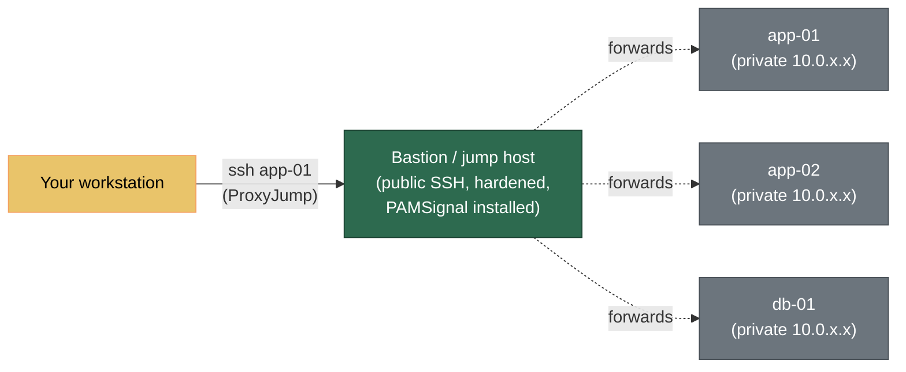

# Bảo mật SSH & Quản lý Fleet

> [English](../ssh-hardening.md) · **Tiếng Việt**

SSH là cửa ngõ vào Linux server của bạn. PAMSignal báo cho bạn ngay khi có người gõ cửa, lay tay nắm, hay lọt được vào trong. Hướng dẫn này nói về việc làm cho chính cánh cửa đó vững chắc, biết chính xác ai đã đi qua cửa và họ đã làm gì, và cách quản lý cánh cửa ấy trên một server hay năm mươi server mà không bị rối.

Nếu trước giờ bạn chỉ đăng nhập bằng `root` với password, vài phần dưới đây có thể hơi nhiều thứ phải tiếp thu một lúc. Không sao: bạn chỉ làm **một lần cho mỗi server** rồi quên nó đi, và PAMSignal theo dõi suốt quá trình nên mỗi thay đổi đều có phản hồi tức thì cho biết nó đã có hiệu lực.

> **Chưa quen gì với mấy thứ này?** Hãy đọc [Bắt đầu nhanh](README.md#bắt-đầu-nhanh) trước để cài PAMSignal và thấy ít nhất một dòng trong `journalctl -t pamsignal`. Rồi quay lại đây.

---

## PAMSignal nằm ở đâu

PAMSignal là **một tầng** trong mô hình phòng thủ nhiều lớp (defence-in-depth). Nó làm đúng một việc (*phát hiện và cảnh báo*) và làm tốt việc đó. Các tầng còn lại vẫn là phần việc của bạn. Hướng dẫn này lo tầng quan trọng nhất (Tầng 1) và phần cơ bản của việc biết ai đã làm gì sau sự việc (Tầng 4):

| Tầng | Mục tiêu | Công cụ thường dùng | Ai lo |
|---|---|---|---|
| **1. Phòng ngừa (Prevention)** | Làm cánh cửa khó mở | **Tài khoản riêng thay vì root, SSH key-only auth, hardening `sshd_config`, firewall** | **Bạn: [Phần 1](#phần-1-hardening-ssh-cho-một-server)** |
| 2. Toàn vẹn (Integrity) | Phát hiện hệ thống bị can thiệp | AIDE, `debsums`, `rpm -V` | Bạn |
| **3. Phát hiện / Cảnh báo (Detection / Alerting)** | Báo cho bạn khi có chuyện | **PAMSignal** | **PAMSignal** |
| **4. Điều tra (Forensics)** | Dựng lại ai đã làm gì, sau sự việc | **sudo log, `auditd`, một bản sao log nằm ngoài server** | **Bạn: [Phần 2](#phần-2-biết-ai-đã-làm-gì-trên-server-dùng-chung)** |

PAMSignal **không bao giờ đụng vào `sshd`**: nó không sửa cấu hình SSH, không cài PAM module, cũng không chặn gì. Nó đọc sự kiện PAM từ systemd journal rồi báo cho bạn. Nhờ vậy, hardening SSH (trang này) và phát hiện tấn công nhắm vào nó (PAMSignal) là hai việc tách bạch, bổ trợ cho nhau: hardening thu hẹp bề mặt tấn công, còn PAMSignal cho bạn biết khi phần bề mặt còn lại bị thử, và khi có thứ gì lọt qua.

Mảnh ghép tự nhiên thứ ba là **chặn tự động**: xem [Hướng dẫn tích hợp Fail2ban](examples/fail2ban.md), nơi Fail2ban dựa vào tín hiệu brute-force của PAMSignal để chặn IP kẻ tấn công ngay tại firewall.

---

## Phần 1: Hardening SSH cho một server

Mọi thứ trong phần này chạy **trên server**. Hãy làm qua một phiên SSH đang mở sẵn, và **giữ phiên đó mở** cho tới khi bạn xác nhận đăng nhập mới hoạt động. Chỉ một thói quen đó thôi đã đủ tránh mọi câu chuyện "tự khóa mình ra ngoài" mà bạn từng nghe.

### 1.1 Đừng đăng nhập bằng root: mỗi người một tài khoản

Phần lớn mọi người bắt đầu bằng việc đăng nhập `root` cho mọi thứ, và nhiều team sau đó phát cho mỗi thành viên một key vào chính tài khoản `root` đó. Chuyển sang SSH key là một bước tiến lớn so với password, nhưng **đăng nhập bằng root vẫn rủi ro kể cả khi dùng key**:

- **Mất một key là mất toàn quyền ngay lập tức.** Một key bị copy từ laptop, từ CI runner hay từ bản backup sẽ vào thẳng root. Với tài khoản riêng, kẻ tấn công chỉ vào được dưới dạng user thường và vẫn phải vượt qua `sudo`: thêm một lớp chặn, và thêm một cơ hội để bạn phát hiện.
- **Mọi sai sót đều chạy với toàn quyền.** Một lệnh `rm -rf`, `chmod -R` hay `> /etc/…` gõ nhầm trong shell root sẽ chạy luôn mà không hỏi lại. Dưới user thường, lệnh đó bị từ chối và bạn có thời gian nghĩ lại.
- **`root` là username mà con bot nào cũng biết.** Các scanner quét khắp internet thử `root` đầu tiên, cả ngày. Không cho root đăng nhập là loại bỏ hoàn toàn mục tiêu bị đoán nhiều nhất.

Trên server **dùng chung**, đăng nhập bằng root còn xóa sạch khả năng truy trách nhiệm. Khi năm người cùng vào `root` bằng năm key khác nhau:

| Câu hỏi sau sự cố | Dùng chung tài khoản `root` | Mỗi người một tài khoản + `sudo` |
|---|---|---|
| Ai đã đăng nhập? | Chỉ có fingerprint của key trong log sshd; bạn phải tự dò ngược ra là ai | Tên user: `login_success user=alice` |
| Ai đã lên root? | Ai cũng đang là root sẵn rồi | `sudo` ghi lại mỗi lần lên quyền kèm tên người; alert của PAMSignal hiện `actor=alice` |
| Họ đã chạy những lệnh gì? | Một file `/root/.bash_history` chung, các lệnh lẫn lộn, bị ghi đè mỗi lần logout, và ai cũng xóa được | `sudo` ghi từng lệnh; `auditd` ghi lệnh theo login ID của từng người (xem [Phần 2](#phần-2-biết-ai-đã-làm-gì-trên-server-dùng-chung)) |
| Ai đã sửa `/etc/nginx/nginx.conf`? | Audit trail chỉ ghi `uid=0`, lần nào cũng vậy | `auditd` ghi đúng tên người, kể cả khi họ sửa file với quyền root |
| Có người rời team | Gỡ key của họ khỏi root và hy vọng không ai đã copy nó | Khóa hoặc xóa tài khoản của họ; không có gì dùng chung phải xoay vòng |

Vậy quy tắc rất đơn giản: **mỗi người có tài khoản riêng và key riêng, và làm việc quản trị qua `sudo`.** Tác vụ tự động (CI deploy, backup) cũng có tài khoản riêng, chỉ với những quyền `sudo` nó thực sự cần.

**Tạo tài khoản riêng** (lặp lại cho mỗi người). Public key do chính người đó cung cấp: họ tạo key trên máy của mình như ở [1.2](#12-dùng-ssh-key-không-dùng-password) rồi gửi bạn file `.pub`:

```bash
# Debian / Ubuntu
sudo adduser alice                  # sets a password, used only for sudo prompts; SSH stays key-only
sudo usermod -aG sudo alice

# RHEL / Fedora / AlmaLinux / Rocky
sudo useradd -m alice && sudo passwd alice
sudo usermod -aG wheel alice

# Install alice's PUBLIC key (alice.pub is the file she sent you)
sudo install -d -m 700 -o alice -g alice /home/alice/.ssh
sudo install -m 600 -o alice -g alice alice.pub /home/alice/.ssh/authorized_keys
```

Nhờ người đó thử, **từ một terminal mới**, trước khi bạn đổi bất cứ thứ gì khác:

```bash
ssh alice@your-server.example.com
sudo -v          # asks for alice's password, then succeeds
```

**Chuyển một team ra khỏi tài khoản root dùng chung.** Làm một lần, và giữ phiên root hiện tại luôn mở:

1. **Liệt kê các key đang vào được root** và xác định chủ của từng key:

   ```bash
   sudo ssh-keygen -lf /root/.ssh/authorized_keys     # one line per key: fingerprint + comment
   ```

2. **Xem key nào thực sự đang được dùng.** sshd ghi fingerprint của key đứng sau mỗi lần đăng nhập:

   ```bash
   sudo journalctl -t sshd -t sshd-session --since "-30 days" | grep "Accepted publickey for root"
   # … Accepted publickey for root from 203.0.113.5 port 51234 ssh2: ED25519 SHA256:Xb3f…
   ```

3. **Tạo tài khoản cho từng người** (như trên) và chuyển key của họ từ `authorized_keys` của root sang tài khoản của chính họ.
4. **Từng người xác nhận** họ đăng nhập được và chạy được `sudo -v`.
5. **Đóng cửa root:** vô hiệu hóa các key của root, rồi đặt `PermitRootLogin no` ở [1.3](#13-siết-sshd_config-bằng-drop-in):

   ```bash
   sudo mv /root/.ssh/authorized_keys /root/.ssh/authorized_keys.disabled
   ```

> **Dùng `sudo <lệnh>`, đừng mở shell root.** `sudo -i`, `sudo su -` và `sudo bash` rất tiện, nhưng khi đó `sudo` chỉ ghi lại việc bạn *mở* một shell, không ghi những gì bạn gõ bên trong. Hãy ưu tiên `sudo systemctl restart nginx` hơn là một shell root mở lâu, và bật ghi lại phiên ở [2.3](#23-họ-đã-gõ-gì-bên-trong-shell-root) để trường hợp mở shell cũng được ghi lại.

### 1.2 Dùng SSH key, không dùng password

Password có thể bị đoán, bị lừa lấy (phishing), hoặc bị dò brute-force. SSH key thì không: nó là một bí mật mã hóa không bao giờ rời khỏi máy bạn. Đây là thay đổi mang lại hiệu quả lớn nhất.

**Trên máy của bạn** (laptop/desktop, *không phải* server), tạo một key hiện đại nếu chưa có:

```bash
ssh-keygen -t ed25519 -C "you@workstation"
# Nhấn Enter để dùng đường dẫn mặc định (~/.ssh/id_ed25519).
# LUÔN đặt passphrase: nó mã hóa key khi lưu trên đĩa.
```

`ed25519` là thuật toán được khuyến nghị hiện nay: ngắn, nhanh và mạnh. (Nếu công ty bạn phát hành hardware security key (kiểu YubiKey), hãy dùng `-t ed25519-sk` để private key nằm luôn trên thiết bị phần cứng.)

Copy **public** key lên server, vào **tài khoản của chính bạn**, không phải root:

```bash
ssh-copy-id you@your-server.example.com
# Hoặc, nếu không có ssh-copy-id:
# ssh you@your-server.example.com 'mkdir -p ~/.ssh && cat >> ~/.ssh/authorized_keys' < ~/.ssh/id_ed25519.pub
```

**Giờ hãy thử nó trước khi đổi bất cứ thứ gì khác.** Mở một terminal *mới* và chạy:

```bash
ssh you@your-server.example.com
```

Nếu nó cho bạn vào **mà không hỏi password tài khoản** (việc hỏi passphrase của key là bình thường), nghĩa là key đã chạy. Lúc đó mới đi tiếp.

### 1.3 Siết `sshd_config` bằng drop-in

Các distro hiện đại (Debian 12+, Ubuntu 22.04+, RHEL 9+) đọc thêm cấu hình từ `/etc/ssh/sshd_config.d/*.conf`. Đặt phần hardening vào một file riêng ở đó gọn hơn nhiều so với sửa thẳng vào `sshd_config` lớn: nó không bị đụng tới khi nâng cấp package, và rất dễ rà soát hay gỡ bỏ.

Tạo file `/etc/ssh/sshd_config.d/00-hardening.conf`:

```ini
# Xác thực: chỉ dùng key, không password, không cho root đăng nhập dưới mọi hình thức.
PubkeyAuthentication yes
PasswordAuthentication no
KbdInteractiveAuthentication no
PermitRootLogin no
PermitEmptyPasswords no

# Làm chậm lại và giới hạn mỗi lần thử kết nối.
MaxAuthTries 3
LoginGraceTime 20
MaxSessions 4

# Chỉ những user (hoặc group) này mới được đăng nhập. Sửa lại cho đúng tài khoản của bạn.
AllowUsers alice bob deploy
# AllowGroups ssh-users

# Tắt những thứ gần như chắc chắn bạn không cần.
X11Forwarding no
AllowAgentForwarding no
```

Vài điểm quan trọng:

- **`PermitRootLogin no`** từ chối mọi lần đăng nhập root, bằng key hay password. Chỉ đặt nó **sau khi** tài khoản của chính bạn đăng nhập được và `sudo -v` chạy được ([1.1](#11-đừng-đăng-nhập-bằng-root-mỗi-người-một-tài-khoản)); nếu không bạn sẽ tự khóa mình ra ngoài. Nếu chưa thể bỏ root ngay, hãy dùng `PermitRootLogin prohibit-password` (chỉ cho dùng key) như một bước tạm thời, không phải đích đến.
- **Tiền tố tên file có ý nghĩa.** `sshd` dùng giá trị **đầu tiên** mà nó gặp cho mỗi keyword, và `Include /etc/ssh/sshd_config.d/*.conf` đọc các file theo thứ tự bảng chữ cái. Cloud image thường kèm sẵn một file `50-cloud-init.conf` *bật* password auth; tiền tố `00-` xếp trước nên giá trị của bạn thắng. Nếu thấy thiết lập của mình bị bỏ qua, gần như luôn là vì lý do này. Kiểm tra giá trị *thực tế* bằng `sudo sshd -T | grep -i passwordauthentication`.
- **`AllowUsers`** là một danh sách cho phép rất mạnh: ai không có tên trong đó thì đơn giản là không xác thực được. Nhớ thêm tài khoản của chính bạn vào trước khi reload. Với một team, dùng `AllowGroups ssh-users` cùng `sudo usermod -aG ssh-users alice` sẽ dễ quản lý hơn.

### 1.4 Validate rồi reload (không ngắt phiên đang dùng)

**Luôn** kiểm tra cú pháp trước khi áp dụng, vì một lỗi gõ nhầm ở đây có thể khóa tất cả mọi người ra ngoài:

```bash
sudo sshd -t          # không in ra gì nếu cấu hình hợp lệ
sudo sshd -T | grep -iE 'passwordauthentication|permitrootlogin|allowusers'   # xác nhận giá trị thực tế
```

Rồi reload. *Reload* đọc lại cấu hình mà không cắt các kết nối đang có:

```bash
# Debian / Ubuntu: unit tên là "ssh"
sudo systemctl reload ssh

# RHEL / Fedora / AlmaLinux / Rocky: unit tên là "sshd"
sudo systemctl reload sshd
```

**Bước kiểm tra an toàn:** vẫn để phiên hiện tại mở, mở thêm một terminal mới và SSH vào lại. Vào được là xong. Không vào được thì bạn vẫn còn phiên cũ để sửa. Đừng đóng phiên đầu tiên cho tới khi phiên mới thành công.

### 1.5 Xem PAMSignal xác nhận

Đây là phần thú vị nhất. Tail PAMSignal và xem thay đổi của bạn có hiệu lực ngay trước mắt:

```bash
journalctl -t pamsignal -f
```

- Đăng nhập bằng key của bạn hiện ra dưới dạng `login_success user=alice ... auth=publickey`, với tên của bạn, không phải `root`.
- Khi bạn chạy `sudo`, bạn thấy `session_opened user=root actor=alice service=sudo`: biết ai đã lên root, chứ không chỉ biết là có người lên root.
- Một con bot thử password giờ thất bại *ngay lập tức*: bạn sẽ thấy `login_failure ... auth=password`, không còn cửa nào để thành công.
- Khi một IP vượt `fail_threshold`, bạn nhận được một dòng `brute_force_detected` (và một chat alert nếu đã cấu hình).

Vậy là vòng tròn đã khép lại: phòng ngừa (Phần 1) làm cánh cửa vững chắc, còn phát hiện (PAMSignal) chứng minh điều đó và canh chừng nó.

### 1.6 Tùy chọn nâng cao

- **Đổi port.** Chuyển SSH khỏi cổng `22` (ví dụ `Port 2222`) không ngăn được kẻ tấn công *có chủ đích*, nhưng cắt giảm đáng kể tiếng ồn từ các scanner quét khắp internet, tức là ít alert rác hơn. Nếu làm vậy, nhớ cập nhật firewall và `~/.ssh/config` ([Phần 3](#phần-3-quản-lý-nhiều-server-mà-không-đau-đầu)). Security-by-obscurity chỉ là điểm cộng, đừng bao giờ coi nó là phương án chính.
- **Firewall.** Giới hạn cổng 22/2222 cho những IP đã biết ở nơi nào có thể (`ufw`, `firewalld`, hoặc security group của nhà cung cấp cloud). Một bastion ([Phần 3](#phần-3-quản-lý-nhiều-server-mà-không-đau-đầu)) cho phép bạn chỉ phơi SSH ra trên *một* host thay vì tất cả.
- **2FA.** Với host quan trọng, thêm TOTP qua `libpam-google-authenticator`. Đây vẫn là Tầng 1 (phòng ngừa) và nằm trong PAM stack của bạn; PAMSignal chỉ việc báo lại các lần thành công và thất bại do nó sinh ra.

---

## Phần 2: Biết ai đã làm gì trên server dùng chung

Khi nhiều người cùng quản trị một server, sớm muộn sẽ có người hỏi: *ai đã restart database, ai đã sửa file cấu hình này, ai đã xóa file kia?* Với tài khoản riêng ([1.1](#11-đừng-đăng-nhập-bằng-root-mỗi-người-một-tài-khoản)), câu hỏi nào cũng có câu trả lời. Phần này chỉ ra mỗi câu trả lời nằm ở đâu và cách bật những thành phần mặc định đang tắt.

### 2.1 Ai đã đăng nhập, bằng key nào

- **PAMSignal** ghi lại mọi lần đăng nhập kèm username, IP nguồn và phương thức xác thực; xem bằng `journalctl -t pamsignal`, hoặc qua chat alert.
- **sshd** ghi fingerprint của chính xác key đã dùng. Nếu một người có nhiều key (laptop, máy bàn), thông tin này cho biết họ vào từ thiết bị nào:

  ```bash
  sudo journalctl -t sshd -t sshd-session | grep "Accepted publickey"
  # … Accepted publickey for alice from 203.0.113.5 port 51234 ssh2: ED25519 SHA256:Xb3f…

  sudo ssh-keygen -lf /home/alice/.ssh/authorized_keys     # match the fingerprint to a key comment
  ```

- **`last`** và **`lastlog`** cho bạn cái nhìn nhanh về các lần đăng nhập gần đây và lần đăng nhập cuối của từng tài khoản.

### 2.2 Ai đã lên root, và các lệnh họ chạy bằng sudo

`sudo` ghi một dòng vào journal cho mỗi lệnh, kèm tên người thật, không cần cài gì thêm:

```bash
sudo journalctl -t sudo --since today
# … sudo[48211]:    alice : TTY=pts/1 ; PWD=/home/alice ; USER=root ; COMMAND=/usr/bin/systemctl restart nginx
```

PAMSignal biến chính khoảnh khắc đó thành một alert `session_opened … actor=alice service=sudo`, nên bạn thấy các lần lên quyền theo thời gian thực. `actor=` là tài khoản đã đăng nhập vào phiên đó: nếu alice chạy `su - bob` trước rồi bob mới chạy `sudo`, alert vẫn ghi `alice`, còn log này ghi `bob`. Một người gõ sai password `sudo` nhiều lần sẽ sinh ra alert `brute_force_detected actor=… target=root`.

Lỗ hổng còn lại: nếu ai đó chạy `sudo -i`, `sudo su -` hay `sudo bash`, log này chỉ cho thấy một shell đã được mở. Hai mục tiếp theo lấp lỗ hổng đó.

### 2.3 Họ đã gõ gì bên trong shell root

**Cách A: ghi lại phiên sudo.** sudo có thể ghi lại output trên terminal của mọi phiên nó khởi chạy, kể cả shell root, và phát lại sau đó như xem video. Tạo file `/etc/sudoers.d/10-session-log` bằng `sudo visudo -f /etc/sudoers.d/10-session-log`:

```text
Defaults use_pty
Defaults log_output
Defaults!/usr/bin/sudoreplay !log_output
```

```bash
sudo sudoreplay -l user alice            # list alice's recorded sessions
sudo sudoreplay 000003                   # replay one session (the TSID from the list)
```

Bản ghi được lưu trong `/var/log/sudo-io/`, chỉ root đọc được. Nên dùng `log_output` thay vì `log_input`: ghi input sẽ bắt cả những phím gõ không hiện trên màn hình, chẳng hạn password gõ vào chương trình khác.

**Cách B: ghi lệnh bằng `auditd`.** Hệ thống audit của Linux ghi lại mọi chương trình một người khởi chạy, gắn với **login ID** (`auid`) của họ. Login ID được đặt một lần lúc đăng nhập và không đổi khi họ chạy `sudo` hay `su`. Vì vậy kể cả bên trong shell root, mỗi lệnh vẫn được ghi dưới tên của người đã mở phiên đó.

```bash
# Debian / Ubuntu (RHEL-family systems already have it, as the "audit" package)
sudo apt-get install auditd
```

Tạo file `/etc/audit/rules.d/50-user-commands.rules`:

```text
# Keep the login ID from being changed after login.
--loginuid-immutable

# Every program started by a human (auid >= 1000), including under sudo / su.
-a always,exit -F arch=b64 -S execve -F auid>=1000 -F auid!=unset -k user-cmd
-a always,exit -F arch=b32 -S execve -F auid>=1000 -F auid!=unset -k user-cmd
```

```bash
sudo augenrules --load
sudo ausearch -k user-cmd -ul "$(id -u alice)" --start today -i
# type=EXECVE … : argc=3 a0=systemctl a1=restart a2=nginx
# type=SYSCALL … : … auid=alice uid=root euid=root … tty=pts1 ses=12 comm=systemctl exe=/usr/bin/systemctl key=user-cmd
```

`auid=alice uid=root` đọc là "alice, đang hành động với quyền root". `ses=12` gom mọi lệnh thuộc cùng một phiên đăng nhập. Ghi lệnh sinh ra rất nhiều bản ghi trên server bận rộn, nên hãy kiểm tra `max_log_file` và `num_logs` trong `/etc/audit/auditd.conf` để chắc chắn ổ đĩa giữ đủ lịch sử bạn cần.

Những điều nên biết khi đọc kết quả:

- **Chỉ xem các dòng lệnh:** mỗi lệnh là một bản ghi `EXECVE` (đã chạy gì) đi kèm một bản ghi `SYSCALL` (ai đã chạy). Thêm `| grep '^type=EXECVE'` để chỉ xem các lệnh.
- **Bản ghi "nền" ở mỗi lần đăng nhập:** việc đăng nhập chạy các script lúc login (message of the day, phiên systemd của user) dưới login ID của người đó, nên mỗi lần đăng nhập thêm vài chục bản ghi ngoài những gì họ gõ.
- **Lệnh có sẵn của shell không phải chương trình:** `echo`, `cd` và chuyển hướng như `> file` không khởi chạy chương trình nào, nên không bao giờ xuất hiện ở đây. File watch (2.4) sẽ ghi lại những gì chúng thay đổi.
- **Trong script và cron job, thêm `--input-logs`:** khi không có terminal, `ausearch` đọc từ standard input thay vì từ audit log và in ra `<no matches>`.

Dùng A khi cần "cho tôi xem chính xác những gì đã hiện trên màn hình", và B khi cần "liệt kê mọi lệnh người này đã chạy"; trên server production dùng chung, hãy chạy cả hai.

### 2.4 Ai đã sửa file nào

`auditd` cũng có thể theo dõi những file quan trọng và ghi lại mọi lần ghi hoặc đổi quyền, cũng kèm login ID của người thực hiện:

```text
# /etc/audit/rules.d/60-watch-files.rules: adjust the paths to your server
-w /etc/ssh/sshd_config -p wa -k sshd-config
-w /etc/ssh/sshd_config.d/ -p wa -k sshd-config
-w /etc/sudoers -p wa -k sudoers
-w /etc/sudoers.d/ -p wa -k sudoers
-w /etc/nginx/ -p wa -k nginx-config
-w /var/www/ -p wa -k webroot
```

```bash
sudo augenrules --load
sudo ausearch -k nginx-config --start today -i
# … auid=alice uid=root … comm=vim exe=/usr/bin/vim.basic … name=/etc/nginx/nginx.conf … key=nginx-config
```

`-p wa` nghĩa là các lần ghi và đổi thuộc tính (owner, mode). Theo dõi cả thư mục sẽ bắt được cả những editor lưu qua file tạm rồi đổi tên. Tránh theo dõi toàn bộ `/etc` hay `/var`: các lần nâng cấp package sẽ chôn vùi những thay đổi bạn thực sự quan tâm.

### 2.5 Vì sao lịch sử shell không phải là audit trail

`~/.bash_history` chỉ là tiện ích, không phải bằng chứng:

- Nó được ghi khi shell thoát, nên một phiên đang mở, hoặc bị kill, có thể bị thiếu.
- Chủ của nó có thể sửa hoặc xóa, tắt nó bằng `unset HISTFILE`, hoặc giấu một lệnh bằng cách gõ dấu cách ở đầu.
- Trên tài khoản `root` dùng chung, mọi người cùng ghi vào một file `/root/.bash_history`, nên không thể biết lệnh nào của ai.

Hãy dùng sudo log, bản ghi phiên sudo và `auditd` (2.2–2.4) làm hồ sơ về những gì đã xảy ra. History chỉ để nhắc trí nhớ.

### 2.6 Giữ dấu vết ở nơi kẻ xâm nhập không xóa được

Bất kỳ ai có quyền root trên server đều có thể xóa log cục bộ và dừng `auditd`. Để có hồ sơ đáng tin sau một vụ xâm nhập, hãy giữ một bản sao ở nơi khác:

- **Làm journal tồn tại lâu dài** để nó còn sau khi reboot: `sudo mkdir -p /var/log/journal && sudo systemctl restart systemd-journald` (đa số distro đã làm sẵn).
- **Đẩy log ra khỏi server** ngay khi chúng được ghi: `systemd-journal-upload`, rsyslog forwarding, hoặc pipeline Grafana/Loki trong [Grafana từ con số 0](grafana-getting-started.md). Với bản ghi audit, `audisp-remote` gửi chúng về một `auditd` trung tâm.
- **Khóa audit rule** bằng cách thêm `-e 2` làm rule cuối cùng: khi đó không ai sửa hay gỡ được các rule mà không reboot, và chính việc reboot cũng để lại dấu vết.
- **Chat alert của PAMSignal vốn đã nằm ngoài server.** Kể cả khi journal cục bộ bị xóa sau đó, alert cho biết ai đã đăng nhập và ai đã lên root đã nằm sẵn trong kênh chat của bạn.

### 2.7 Tìm ở đâu: tra cứu nhanh

| Câu hỏi | Câu trả lời nằm ở đâu | Lệnh |
|---|---|---|
| Ai đã đăng nhập, từ đâu? | PAMSignal, theo thời gian thực | `journalctl -t pamsignal` |
| Bằng key nào (thiết bị nào)? | Log sshd, fingerprint của key | `journalctl -t sshd -t sshd-session \| grep Accepted` |
| Ai đã lên root? | sudo log, `actor=` của PAMSignal | `journalctl -t sudo` |
| Những lệnh nào chạy bằng sudo? | sudo log | `journalctl -t sudo` |
| Chuyện gì xảy ra bên trong shell root? | Bản ghi phiên sudo | `sudoreplay -l user alice` |
| Mọi lệnh một người đã chạy, kể cả với quyền root | `auditd`, theo login ID | `ausearch -k user-cmd -ul <uid> -i` |
| Ai đã sửa một file? | File watch của `auditd` | `ausearch -k <key> -i` |
| Có tin được log cục bộ không? | Chỉ khi đã có một bản sao rời khỏi server | Log server / Loki của bạn |

Để có tất cả những câu trả lời này trong một báo cáo, hãy dùng script chỉ đọc [`who-did-what`](examples/who-did-what.md): `sudo who-did-what --user alice --since yesterday`.

---

## Phần 3: Quản lý nhiều server mà không đau đầu

Khi bạn có hơn hai ba server, hai vấn đề nảy sinh: bạn không nhớ nổi IP/port/user của từng máy, và bạn không muốn phơi SSH ra internet trên mọi máy. Cả hai đều giải quyết được **ngay trên máy của bạn** bằng `~/.ssh/config`, không phải đụng gì tới server.

### 3.1 Đặt tên cho mỗi server

Tạo hoặc sửa `~/.ssh/config` trên laptop của bạn:

```ini
# ~/.ssh/config: trên MÁY của bạn, không phải trên server.

# Mặc định áp dụng cho mọi host bên dưới.
Host *
    AddKeysToAgent yes
    ServerAliveInterval 60
    ServerAliveCountMax 3
    HashKnownHosts yes

Host web-01
    HostName 203.0.113.10
    User alice
    Port 2222
    IdentityFile ~/.ssh/id_ed25519

Host web-02
    HostName 203.0.113.11
    User alice

# Một block có thể bao cả một quy ước đặt tên nhờ wildcard.
Host db-*
    User alice
    IdentityFile ~/.ssh/id_ed25519_db
```

Giờ thay vì `ssh -p 2222 alice@203.0.113.10`, bạn chỉ gõ:

```bash
ssh web-01
```

Tab-completion, `scp file web-02:/tmp/`, và `rsync` đều hiểu các alias này. Đây là nâng cấp tiện lợi đáng giá nhất khi quản lý fleet, và nó khiến phần triển khai ở [Phần 4](#phần-4-triển-khai-pamsignal-cho-toàn-fleet) trở nên đơn giản, vì mọi công cụ đều có thể gọi host bằng tên.

### 3.2 Truy cập server private qua bastion (jump host)

Cách tốt nhất để mở SSH cho cả fleet là chỉ mở trên **đúng một** host đã hardening và được giám sát (gọi là *bastion*, hay *jump host*), rồi giữ mọi server khác trong mạng private, chỉ vào được thông qua nó. `ProxyJump` biến việc này thành một dòng từ phía bạn:

```ini
Host bastion
    HostName bastion.example.com
    User alice
    Port 2222

# Mọi host trong dải private 10.0.x.x đều vào qua bastion.
Host 10.0.*.*
    ProxyJump bastion
    User alice

Host app-01
    HostName 10.0.1.21
    ProxyJump bastion
    User alice
```

Giờ `ssh app-01` tự động đi vòng qua bastion một cách trong suốt. Kết nối tới `app-01` được mã hóa end-to-end. Bastion chỉ chuyển tiếp gói tin, nó không bao giờ thấy nội dung phiên của bạn.



**Vì sao nó hợp với PAMSignal đến vậy:** bastion trở thành bề mặt SSH duy nhất hướng ra internet, nên nó hứng gần như toàn bộ lưu lượng brute-force. Cài PAMSignal ở đó thì alert tập trung đúng nơi tấn công đổ về. Cài luôn trên các host private nữa thì bất kỳ lần đăng nhập nào *không* đi qua bastion đều là dấu hiệu đáng nghi ngay lập tức.

> **Ưu tiên `ProxyJump` hơn agent forwarding.** Agent forwarding (`ForwardAgent yes`) phơi key của bạn ra host mà bạn vừa vào. `ProxyJump` thì không: key của bạn không bao giờ chạm tới bastion. Chỉ forward agent tới những host bạn hoàn toàn tin tưởng.

### 3.3 Quản lý key ở quy mô fleet

- **Mỗi người một tài khoản và một key, không bao giờ dùng chung tài khoản hay dùng chung key** ([1.1](#11-đừng-đăng-nhập-bằng-root-mỗi-người-một-tài-khoản)). Khi một admin nghỉ, bạn chỉ cần khóa tài khoản *của họ* và gỡ public key *của họ* ở mọi nơi, không phải xoay (rotate) một bí mật mà cả nhóm dùng chung.
- **Phân phối tài khoản và `authorized_keys` bằng config management** ([Phần 4](#phần-4-triển-khai-pamsignal-cho-toàn-fleet)), đừng làm tay. Một file bạn sửa thủ công trên 30 server thì sớm muộn cũng mỗi nơi một khác.
- **Dùng passphrase + `ssh-agent`** để key được mã hóa khi lưu nhưng bạn chỉ phải gõ passphrase một lần mỗi phiên.

---

## Phần 4: Triển khai PAMSignal cho toàn fleet

Cửa đã chắc; giờ đặt một cảm biến sau mỗi cánh cửa. Mục tiêu: mọi host đều chạy PAMSignal, dùng chung một cấu hình hợp lý, và cùng báo về một chỗ (chat cho cảnh báo tức thì, [Grafana](grafana-getting-started.md) cho góc nhìn toàn fleet).

### 4.1 Cách nhanh: vòng lặp qua các SSH alias

Với một vài host, các tên trong `~/.ssh/config` ở [Phần 3](#phần-3-quản-lý-nhiều-server-mà-không-đau-đầu) là đủ cho một dòng lệnh. Cài đặt theo [hướng dẫn Triển khai](deployment.md) trên từng máy:

```bash
for h in bastion web-01 web-02 db-01; do
  echo "== installing on $h =="
  ssh "$h" 'sudo apt-get update && sudo apt-get install -y pamsignal'   # giả định repo đã được cấu hình
done
```

…rồi kiểm tra cả fleet một lượt:

```bash
for h in bastion web-01 web-02 db-01; do
  echo "== $h =="
  ssh "$h" 'systemctl is-active pamsignal; journalctl -t pamsignal -n 2 --no-pager'
done
```

### 4.2 Cách tái lập được: Ansible

Vượt quá một vài host thì nên dùng config management để cả việc cài đặt **lẫn** cấu hình đều tái lập được. Ansible đọc trực tiếp các alias trong `~/.ssh/config` của bạn. Một điểm khởi đầu tối giản:

```ini
# inventory.ini
[pamsignal_fleet]
bastion
web-01
web-02
db-01
```

```yaml
# install-pamsignal.yml
- hosts: pamsignal_fleet
  become: true
  tasks:
    - name: Install pamsignal (Debian/Ubuntu)
      ansible.builtin.apt:
        name: pamsignal
        state: present
        update_cache: true
      when: ansible_os_family == "Debian"

    - name: Install pamsignal (RHEL family)
      ansible.builtin.dnf:
        name: pamsignal
        state: present
      when: ansible_os_family == "RedHat"

    - name: Deploy the shared config
      ansible.builtin.template:
        src: pamsignal.conf.j2
        dest: /etc/pamsignal/pamsignal.conf
        owner: root
        group: pamsignal
        mode: "0640"
      notify: reload pamsignal

    - name: Enable and start
      ansible.builtin.systemd:
        name: pamsignal
        enabled: true
        state: started

  handlers:
    - name: reload pamsignal
      ansible.builtin.systemd:
        name: pamsignal
        state: reloaded
```

```bash
ansible-playbook -i inventory.ini install-pamsignal.yml
```

Vì cấu hình là một template Jinja (`pamsignal.conf.j2`), bạn có thể đặt **context tag riêng cho từng host** từ biến inventory. `provider` và `service_name` được gắn vào mọi alert, nên bạn luôn biết một cảnh báo đến từ host nào (hay khách hàng nào):

```ini
# pamsignal.conf.j2  (trích)
provider = {{ pamsignal_provider | default('selfhosted') }}
service_name = {{ inventory_hostname }}
```

Cách gắn tag theo host như vậy chính là nền tảng cho các mô hình multi-tenant trong [Use Cases → Hosting provider nhỏ](use-cases.md#hosting-provider-nhỏ--msp).

### 4.3 Một cấu hình, nhiều host

Giữ một file `pamsignal.conf` chuẩn duy nhất trong repo config-management rồi đẩy đi mọi nơi. Những key đáng chuẩn hóa trên cả fleet:

- `fail_threshold` / `fail_window_sec`: định nghĩa "brute force" chung cho cả fleet.
- `enable_notification_type`: lọc bớt tiếng ồn trên chat (ví dụ `login_success,brute_force`); journal cục bộ vẫn ghi đủ mọi thứ. Xem [Configuration](configuration.md#bộ-lọc-loại-thông-báo).
- Thông tin xác thực kênh cảnh báo: thường là một kênh chung cho cả fleet, hoặc một kênh cho mỗi môi trường.

Reload mọi nơi sau khi đổi cấu hình mà không cần restart:

```bash
for h in bastion web-01 web-02 db-01; do ssh "$h" 'sudo systemctl reload pamsignal'; done
# …hoặc, với Ansible, chỉ cần chạy lại playbook; handler chỉ reload các host có thay đổi.
```

---

## Đừng tự khóa mình ra ngoài: checklist

Hardening và tự động hóa chính là lúc dễ tự khóa mình ra ngoài nhất. Trước khi rời khỏi bất kỳ host nào:

- [ ] **Vẫn còn một phiên thứ hai đang mở** trong khi bạn thử thay đổi.
- [ ] **Một lần đăng nhập SSH mới đã thành công** *trước khi* bạn đóng phiên cũ.
- [ ] **Trước khi đặt `PermitRootLogin no`, tài khoản của chính bạn đăng nhập được và `sudo -v` chạy thành công.**
- [ ] **Tài khoản của bạn nằm trong `AllowUsers`** (nếu bạn có đặt).
- [ ] **Bạn biết đường vào out-of-band** (serial console của cloud, hypervisor, hoặc truy cập vật lý) phòng khi mọi đường SSH đều hỏng.
- [ ] Nếu bạn cũng chạy [Fail2ban](examples/fail2ban.md), **IP của chính bạn nằm trong `ignoreip`** để một lần gõ nhầm password không tự ban mất bạn.

---

## PAMSignal bổ trợ thế nào (nhìn nhanh)

| Bạn đã làm gì | Tầng | Được lợi gì | PAMSignal thêm vào gì |
|---|---|---|---|
| Mỗi người một tài khoản, `PermitRootLogin no` | Phòng ngừa | Mất một key không còn đồng nghĩa với mất root ngay; mọi hành động đều có tên người | Alert đăng nhập và `sudo`/`su` ghi rõ tên người (`user=`, `actor=`) |
| Key-only auth, hardening `sshd_config` | Phòng ngừa | Tấn công bằng password không thể thành công | Báo ngay khi có người thử, và xác nhận từng lần đăng nhập hợp lệ |
| sudo log, `auditd`, log nằm ngoài server | Điều tra | Trả lời được "ai đã chạy gì, ai đã sửa file nào" | Một alert tức thì chỉ đúng phiên cần điều tra |
| Bastion + mạng private | Phòng ngừa | Một bề mặt tấn công nhỏ thay vì nhiều | Gom alert về bastion; gắn cờ mọi lần đăng nhập né được nó |
| Fail2ban dựa trên tín hiệu brute-force | Phản ứng | Kẻ tái phạm bị chặn tại firewall | Cung cấp tín hiệu `brute_force_detected` đã kiểm chứng để Fail2ban hành động |
| Triển khai fleet + tag theo host | Vận hành | Fleet tái lập được, có tên, được giám sát | Một góc nhìn tức thì + [một góc nhìn toàn fleet](grafana-getting-started.md) cho mọi hoạt động auth |

PAMSignal không *thay thế* bất cứ thứ nào ở trên; nó làm chúng quan sát được. Một server đã hardening mà bạn không nhìn thấy gì là một server bạn đang tin tưởng một cách mù quáng; PAMSignal là cách bạn thôi tin mù quáng.

---

## Đọc thêm

- **[Triển khai](deployment.md)**: cài đặt, các chỉ thị hardening của systemd, gỡ cài đặt
- **[Configuration](configuration.md)**: mọi config key, gồm cả bộ lọc loại thông báo
- **[Tích hợp Fail2ban](examples/fail2ban.md)**: biến tín hiệu brute-force thành lệnh ban IP tự động
- **[Grafana từ con số 0](grafana-getting-started.md)**: một dashboard cho hoạt động auth của cả fleet
- **[Threat Model: Phạm vi quan sát](threat-model.md#phạm-vi-quan-sát)**: những kênh PAMSignal thấy và không thấy (đọc phần này trước khi cho rằng SSH là cánh cửa duy nhất)
- **[Use Cases](use-cases.md)**: playbook cho cá nhân, nhóm nhỏ, và hosting provider
